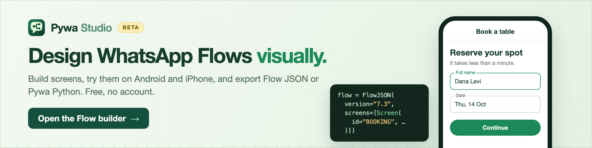
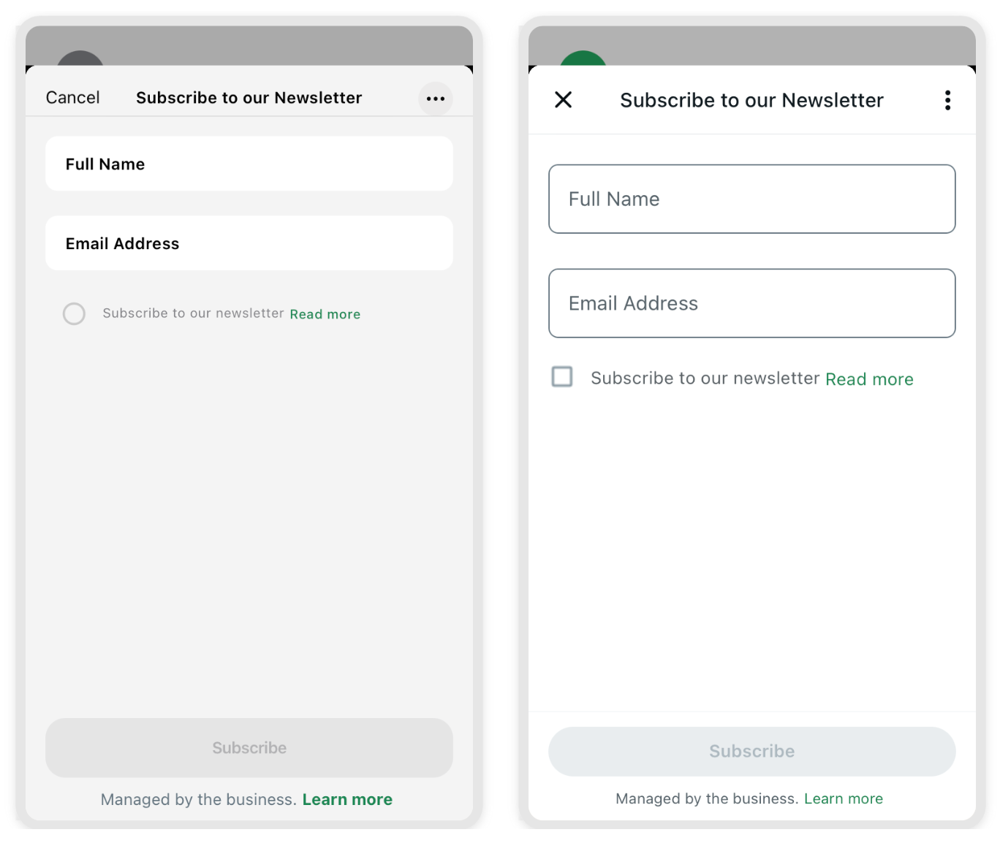

# ♻️ Flows

PyWa has built-in support for WhatsApp Flows, allowing you to create rich, structured interactions with your users directly within WhatsApp.

Flows let your users perform complex tasks — such as booking appointments, browsing products, or completing sign-up forms — without leaving the chat interface.

[](https://studio.pywa.cloud/flows)

Working with WhatsApp Flows in PyWa involves four main steps:

- Creating the Flow
- Sending the Flow
- Handling Flow requests and responding to them (for dynamic flows)
- Receiving the Flow Completion update

## Creating Flow

First you need to create the flow, give it a name and set the categories by calling [`create_flow()`][pywa.client.WhatsApp.create_flow]:
You can also create the flows using the [WhatsApp Flow Builder](https://business.facebook.com/wa/manage/flows/).


```python linenums="1"
from pywa import WhatsApp
from pywa.types import FlowCategory

# WhatsApp Business Account ID (WABA) is required
wa = WhatsApp(..., waba_id="1234567890123456")

created = wa.create_flow(
    name="My New Flow", categories=[FlowCategory.CUSTOMER_SUPPORT, FlowCategory.SURVEY]
)
print(wa.get_flow(created.id))

# FlowDetails(id='1234567890123456', name='My New Flow', status=FlowStatus.DRAFT, ...)
```


Now you can start building the flow structure.


!!! tip

    Tip


    You can also provide the flow json when creating the flow by passing the `flow_json` argument to [`create_flow()`][pywa.client.WhatsApp.create_flow], but here we treat it separately.


    ```python linenums="1"
    created = wa.create_flow(
        name="My New Flow",
        categories=[FlowCategory.CUSTOMER_SUPPORT, FlowCategory.SURVEY],
        flow_json=FlowJSON(...)  # The flow json to create,
        publish=True,  # If you want to publish the flow immediately
    )
    ```


A flow is collection of screens containing components. screens can exchange data with each other and with your server.

Flow can be static: all the components settings are predefined and no interaction is required from your server. Or it can be dynamic: your server can respond to screen actions and determine the next screen to display (or close the flow) and the data to provide to it.

## Available components

Every component on the FlowJSON has a corresponding class in `pywa.types.flows`:

| Category                        | Types                                                                                                                                                                              |
|---------------------------------|------------------------------------------------------------------------------------------------------------------------------------------------------------------------------------|
| Static elements                 | [`RichText`][pywa.types.flows.RichText], [`TextHeading`][pywa.types.flows.TextHeading], [`TextSubheading`][pywa.types.flows.TextSubheading], [`TextBody`][pywa.types.flows.TextBody], [`TextCaption`][pywa.types.flows.TextCaption], [`Image`][pywa.types.flows.Image]                                                                                           |
| Collect data                    | [`Form`][pywa.types.flows.Form], [`TextInput`][pywa.types.flows.TextInput], [`TextArea`][pywa.types.flows.TextArea], [`RadioButtonsGroup`][pywa.types.flows.RadioButtonsGroup], [`CheckboxGroup`][pywa.types.flows.CheckboxGroup], [`ChipsSelector`][pywa.types.flows.ChipsSelector], [`Dropdown`][pywa.types.flows.Dropdown], [`OptIn`][pywa.types.flows.OptIn], [`DatePicker`][pywa.types.flows.DatePicker], [`CalendarPicker`][pywa.types.flows.CalendarPicker], [`PhotoPicker`][pywa.types.flows.PhotoPicker], [`DocumentPicker`][pywa.types.flows.DocumentPicker] |
| Navigation                      | [`EmbeddedLink`][pywa.types.flows.EmbeddedLink], [`NavigationList`][pywa.types.flows.NavigationList], [`Footer`][pywa.types.flows.Footer]                                                                                                                                        |
| Conditional Component Rendering | [`If`][pywa.types.flows.If], [`Switch`][pywa.types.flows.Switch]                                                                                                                                                       |
| Actions                         | [`DataExchangeAction`][pywa.types.flows.DataExchangeAction], [`NavigateAction`][pywa.types.flows.NavigateAction], [`CompleteAction`][pywa.types.flows.CompleteAction], [`UpdateDataAction`][pywa.types.flows.UpdateDataAction], [`OpenURLAction`][pywa.types.flows.OpenURLAction]                                                                                                          |
| Helpers                         | [`ScreenData`][pywa.types.flows.ScreenData], [`ScreenDataUpdate`][pywa.types.flows.ScreenDataUpdate], [`ScreenDataRef`][pywa.types.flows.ScreenDataRef], [`ComponentRef`][pywa.types.flows.ComponentRef], [`FlowStr`][pywa.types.flows.FlowStr], [`Condition`][pywa.types.flows.Condition], [`MathExpression`][pywa.types.flows.MathExpression]                                                                            |

----------------------------------------------------------------------------------------------------------------------------------------------------------------------------------------------------------------------------------------------------------------------------------------------------------------------------------------------------------------------------------------------------------------------------------------------------------------------------------------------------------------------------------------------------------------------------------------------------------------------------------------------------------------------------------------------------------------------------------------------------------------------------------------------------------------------------------------------------------------------------------------------------------------------------------------------------------------------------------------------------------------------------------------

**Here is an example of static flow:**


```python title="newsletter_flow.py" linenums="1" hl_lines="12 18 24 36-38"
from pywa.types.flows import *

flow = FlowJSON(
    version=7.0,
    screens=[
        Screen(
            id="NEWSLETTER_SUBSCRIPTION",
            title="Subscribe to our Newsletter",
            terminal=True,
            layout=Layout(
                children=[
                    full_name := TextInput(
                        name="full_name",
                        label="Full Name",
                        input_type=InputType.TEXT,
                        required=True,
                    ),
                    email := TextInput(
                        name="email",
                        label="Email Address",
                        input_type=InputType.EMAIL,
                        required=True,
                    ),
                    is_subscribed := OptIn(
                        name="is_subscribed",
                        label="Subscribe to our newsletter",
                        required=True,
                        on_click_action=OpenURLAction(
                            url="https://pywa.readthedocs.io/",
                        ),
                    ),
                    Footer(
                        label="Subscribe",
                        on_click_action=CompleteAction(
                            payload={
                                "full_name": full_name.ref,
                                "email": email.ref,
                                "is_subscribed": is_subscribed.ref,
                            },
                        ),
                    ),
                ],
            ),
        )
    ],
)
```


Which is the equivalent of the following flow json:


??? example "Show"


    ```json title="newsletter_flow.json" linenums="1"
    {
        "version": "7.0",
        "screens": [
            {
                "id": "NEWSLETTER_SUBSCRIPTION",
                "title": "Subscribe to our Newsletter",
                "terminal": true,
                "layout": {
                    "type": "SingleColumnLayout",
                    "children": [
                        {
                            "type": "TextInput",
                            "name": "full_name",
                            "label": "Full Name",
                            "input-type": "text",
                            "required": true
                        },
                        {
                            "type": "TextInput",
                            "name": "email",
                            "label": "Email Address",
                            "input-type": "email",
                            "required": true
                        },
                        {
                            "type": "OptIn",
                            "name": "is_subscribed",
                            "label": "Subscribe to our newsletter",
                            "required": true,
                            "on-click-action": {
                                "name": "open_url",
                                "url": "https://pywa.readthedocs.io/"
                            }
                        },
                        {
                            "type": "Footer",
                            "label": "Subscribe",
                            "on-click-action": {
                                "name": "complete",
                                "payload": {
                                    "full_name": "${form.full_name}",
                                    "email": "${form.email}",
                                    "is_subscribed": "${form.is_subscribed}"
                                }
                            }
                        }
                    ]
                }
            }
        ]
    }
    ```


And this is how it looks like on WhatsApp (iOS/Android):





----------------------------------------------------------------------------------------------------------------------------------------------------------------------------------------------------------------------------------------------------------------------------------------------------------------------------------------------------------------------------------------------------------------------------------------------------------------------------------------------------------------------------------------------------------------------------------------------------------------------------------------------------------------------------------------------------------------------------------------------------------------------------------------------------------------------------------------------------------------------------------------------------------------------------------------------------------------------------------------------------------------------------------------

After you have the flow json, you can update the flow with [`update_flow_json()`][pywa.client.WhatsApp.update_flow_json]:


```python title="update_flow.py" linenums="1" hl_lines="10"
from pywa import WhatsApp
from pywa.types.flows import *

your_flow_json = FlowJSON(...)  # keep edit your flow

if __name__ == "__main__":
    wa = WhatsApp(
        ..., waba_id="1234567890123456"
    )  # waba id is required for creating flows
    # created = wa.create_flow(name="Newsletter Flow", categories=[FlowCategory.CONTACT_US])

    res = wa.update_flow_json(flow_id=created.id, flow_json=newsletter_flow)
    if not res:  # If the flow was not updated successfully
        print("Validation errors:")
        for error in res.validation_errors:
            print(error)
```


The `flow_json` argument can be [`FlowJSON`][pywa.types.flows.FlowJSON], a `dict`, json `str`, json file `pathlib.Path` or a file-like object.

You can get the [`FlowDetails`][pywa.types.flows.FlowDetails] of the flow with [`get_flow()`][pywa.client.WhatsApp.get_flow]:


```python linenums="1"
flow = wa.get_flow(created.id)
print(flow)
```


Or getting all the flows with [`get_flows()`][pywa.client.WhatsApp.get_flows]:


```python linenums="1"
flows = wa.get_flows()
for flow in flows:
    print(flow)
```


To test your flow, you need to send it to a user.

## Sending Flows

Flow is just a [`FlowButton`][pywa.types.callback.FlowButton] attached to a message. Let's see how to send text message with flow:


```python linenums="1" hl_lines="9-15"
from pywa import WhatsApp
from pywa.types import FlowButton

wa = WhatsApp(...)

wa.send_message(
    to="1234567890",
    text="Hi, You need to finish your sign up!",
    buttons=FlowButton(
        title="Finish Sign Up",  # The button title that will appear on the bottom of the message
        flow_id="1234567890123456",  # The `ewsletter_flow` flow id from above
        mode=FlowStatus.DRAFT,  # If the flow is in draft mode, you must specify the mode as `FlowStatus.DRAFT`.
        flow_action_type=FlowActionType.NAVIGATE,  # You tell WhatsApp what to do when the user clicks the button.
        flow_action_screen="SIGN_UP",  # The screen id to navigate to when the user clicks the button.
    ),
)
```


## Getting Flow Completion message

When the user completes the flow, you will receive a request to your webhook with the payload you sent when you completed the flow.

Here is how to listen to flow completion update:


```python linenums="1"
from pywa import WhatsApp
from pywa.types import FlowCompletion

wa = WhatsApp(...)


@wa.on_flow_completion
def on_flow_completion(_: WhatsApp, flow: FlowCompletion):
    print(f"The user {flow.from_user.name} just completed the flow!")
    print(flow.response)
```


The `.response` attribute is the payload you sent when you completed the flow.


!!! note

    Note


    if you using [`PhotoPicker`][pywa.types.flows.PhotoPicker] or [`DocumentPicker`][pywa.types.flows.DocumentPicker] components, you will receive the files inside the flow completion .response. You can constract them into pywa media objects by using [`get_media()`][pywa.types.flows.FlowCompletion.get_media]:


    ```python linenums="1"
    from pywa import WhatsApp, types

    wa = WhatsApp(...)


    @wa.on_flow_completion
    def on_flow_completion(_: WhatsApp, flow: FlowCompletion):
        img = flow.get_media(types.Image, key="profile_pic")
        img.download()
    ```


## Handling Flow Requests

WhatsApp Flows can be dynamic, allowing your server to handle user actions and respond in real-time. For example, you can validate inputs, transition to new screens based on business logic, or complete the interaction dynamically.


!!! warning

    Important


    Because dynamic flow requests and responses contain sensitive data, Meta requires them to be encrypted using [WhatsApp Business Encryption](https://developers.facebook.com/docs/whatsapp/cloud-api/reference/whatsapp-business-encryption).

    Before handling dynamic flows, you must generate and upload an RSA key pair:

    1.  **Generate a private key** (you will be prompted to set a password):


        ```bash
        openssl genrsa -des3 -out private.pem 2048
        ```


    2.  **Export the public key** from your private key:


        ```bash
        openssl rsa -in private.pem -outform PEM -pubout -out public.pem
        ```


    3.  **Upload the public key** to Meta using the [`set_business_public_key()`][pywa.client.WhatsApp.set_business_public_key] method:


        ```python linenums="1"
        from pywa import WhatsApp

        wa = WhatsApp(...)
        wa.set_business_public_key(open("public.pem").read())
        ```


    4.  **Provide the private key** to your [`WhatsApp`][pywa.client.WhatsApp] client initialization:


        ```python linenums="1"
        from pywa import WhatsApp

        wa = WhatsApp(..., business_private_key=open("private.pem").read())
        ```


    5.  **Install the required dependencies** (pywa uses the [cryptography](https://cryptography.io/en/latest/) library for decryption/encryption):


        ```bash
        pip3 install "pywa[cryptography]"
        ```


Let's see an example of a dynamic flow:


```python title="sign_in_flow.py" linenums="1" hl_lines="5-11 13 16 18-27 31 36 38 58-59 66 71 77 83 87 90 94 97 102 105 113 121-127 134 142 146 152"
from pywa.types.flows import *

flow = FlowJSON(
    version="7.2",
    data_api_version="3.0",
    routing_model={
        "SIGN_IN": ["SIGN_UP", "FORGOT_PASSWORD"],
        "SIGN_UP": ["TERMS_AND_CONDITIONS"],
        "FORGOT_PASSWORD": [],
        "TERMS_AND_CONDITIONS": [],
    },
    screens=[
        signin_screen := Screen(
            id="SIGN_IN",
            title="Sign in",
            terminal=True,
            success=True,
            data=[
                welcome := ScreenData(
                    key="welcome",
                    example="Welcome back! Please sign in to continue.",
                ),
                default_email := ScreenData(
                    key="default_email",
                    example="johndoe@gmail.com",
                ),
            ],
            layout=Layout(
                children=[
                    TextSubheading(text=welcome.ref),
                    signin_email := TextInput(
                        name="email",
                        label="Email address",
                        input_type=InputType.EMAIL,
                        required=True,
                        init_value=default_email.ref,
                    ),
                    signin_password := TextInput(
                        name="password",
                        label="Password",
                        input_type=InputType.PASSWORD,
                        required=True,
                    ),
                    EmbeddedLink(
                        text="Don't have an account? Sign up",
                        on_click_action=NavigateAction(next=Next(name="SIGN_UP")),
                    ),
                    EmbeddedLink(
                        text="Forgot password",
                        on_click_action=NavigateAction(
                            next=Next(name="FORGOT_PASSWORD"),
                        ),
                    ),
                    Footer(
                        label="Sign in",
                        on_click_action=DataExchangeAction(
                            payload={
                                "email": signin_email.ref,
                                "password": signin_password.ref,
                            }
                        ),
                    ),
                ]
            ),
        ),
        signup_screen := Screen(
            id="SIGN_UP",
            title="Sign up",
            layout=Layout(
                children=[
                    first_name := TextInput(
                        name="first_name",
                        label="First Name",
                        input_type=InputType.TEXT,
                        required=True,
                    ),
                    last_name := TextInput(
                        name="last_name",
                        label="Last Name",
                        input_type=InputType.TEXT,
                        required=True,
                    ),
                    signup_email := TextInput(
                        name="email",
                        label="Email address",
                        input_type=InputType.EMAIL,
                        init_value=signin_screen / signin_email.ref,
                        required=True,
                    ),
                    signup_password := TextInput(
                        name="password",
                        label="Set password",
                        input_type=InputType.PASSWORD,
                        init_value=signin_screen / signin_password.ref,
                        required=True,
                    ),
                    confirm_password := TextInput(
                        name="confirm_password",
                        label="Confirm password",
                        helper_text="Min 8 chars, incl. 1 number & 1 special character.",
                        input_type=InputType.PASSWORD,
                        init_value=signin_screen / signin_password.ref,
                        required=True,
                    ),
                    terms_agreement := OptIn(
                        name="terms_agreement",
                        label="I agree with the terms.",
                        on_click_action=NavigateAction(
                            next=Next(type="screen", name="TERMS_AND_CONDITIONS")
                        ),
                        required=True,
                    ),
                    offers_acceptance := OptIn(
                        name="offers_acceptance",
                        label="I would like to receive news and offers.",
                    ),
                    Footer(
                        label="Sign up",
                        on_click_action=DataExchangeAction(
                            payload={
                                "first_name": first_name.ref,
                                "last_name": last_name.ref,
                                "email": signup_email.ref,
                                "password": signup_password.ref,
                                "confirm_password": confirm_password.ref,
                                "terms_agreement": terms_agreement.ref,
                                "offers_acceptance": offers_acceptance.ref,
                            }
                        ),
                    ),
                ]
            ),
        ),
        forgot_password_screen := Screen(
            id="FORGOT_PASSWORD",
            title="Forgot password",
            terminal=True,
            success=True,
            layout=Layout(
                children=[
                    TextBody(
                        text="Enter your email address for your account and we'll send a reset link. The single-use link will expire after 24 hours."
                    ),
                    forgot_password_email := TextInput(
                        name="email",
                        label="Email address",
                        input_type=InputType.EMAIL,
                        init_value=signin_screen / signin_email.ref,
                        required=True,
                    ),
                    Footer(
                        label="Send reset link",
                        on_click_action=DataExchangeAction(
                            payload={"email": forgot_password_email.ref}
                        ),
                    ),
                ]
            ),
        ),
        Screen(
            id="TERMS_AND_CONDITIONS",
            title="Terms and conditions",
            layout=Layout(
                children=[
                    TextHeading(text="Our Terms"),
                    TextSubheading(text="Data usage"),
                    TextBody(
                        text="Lorem ipsum dolor sit amet, consectetur adipiscing elit. Sed vitae odio dui. Praesent ut nulla tincidunt, scelerisque augue malesuada, volutpat lorem. Aliquam iaculis ex at diam posuere mollis. Suspendisse eget purus ac tellus interdum pharetra. In quis dolor turpis. Fusce in porttitor enim, vitae efficitur nunc. Fusce dapibus finibus volutpat. Fusce velit mi, ullamcorper ac gravida vitae, blandit quis ex. Fusce ultrices diam et justo blandit, quis consequat nisl euismod. Vestibulum pretium est sem, vitae convallis justo sollicitudin non. Morbi bibendum purus mattis quam condimentum, a scelerisque erat bibendum. Nullam sit amet bibendum lectus."
                    ),
                    TextSubheading(text="Privacy policy"),
                    TextBody(
                        text="Lorem ipsum dolor sit amet, consectetur adipiscing elit. Sed vitae odio dui. Praesent ut nulla tincidunt, scelerisque augue malesuada, volutpat lorem. Aliquam iaculis ex at diam posuere mollis. Suspendisse eget purus ac tellus interdum pharetra. In quis dolor turpis. Fusce in porttitor enim, vitae efficitur nunc. Fusce dapibus finibus volutpat. Fusce velit mi, ullamcorper ac gravida vitae, blandit quis ex. Fusce ultrices diam et justo blandit, quis consequat nisl euismod. Vestibulum pretium est sem, vitae convallis justo sollicitudin non. Morbi bibendum purus mattis quam condimentum, a scelerisque erat bibendum. Nullam sit amet bibendum lectus."
                    ),
                ]
            ),
        ),
    ],
)
```


Which is the equivalent of the following flow json:


??? example "Show"


    ```json title="sign_in_flow.json" linenums="1"
    {
        "version": "7.2",
        "data_api_version": "3.0",
        "routing_model": {
            "SIGN_IN": [
                "SIGN_UP",
                "FORGOT_PASSWORD"
            ],
            "SIGN_UP": [
                "TERMS_AND_CONDITIONS"
            ],
            "FORGOT_PASSWORD": [],
            "TERMS_AND_CONDITIONS": []
        },
        "screens": [
            {
                "id": "SIGN_IN",
                "title": "Sign in",
                "data": {
                    "welcome": {
                        "type": "string",
                        "__example__": "Welcome back! Please sign in to continue."
                    },
                    "default_email": {
                        "type": "string",
                        "__example__": "johndoe@gmail.com"
                    }
                },
                "terminal": true,
                "success": true,
                "layout": {
                    "type": "SingleColumnLayout",
                    "children": [
                        {
                            "type": "TextSubheading",
                            "text": "${data.welcome}"
                        },
                        {
                            "type": "TextInput",
                            "name": "email",
                            "label": "Email address",
                            "input-type": "email",
                            "required": true,
                            "init-value": "${data.default_email}"
                        },
                        {
                            "type": "TextInput",
                            "name": "password",
                            "label": "Password",
                            "input-type": "password",
                            "required": true
                        },
                        {
                            "type": "EmbeddedLink",
                            "text": "Don't have an account? Sign up",
                            "on-click-action": {
                                "name": "navigate",
                                "next": {
                                    "name": "SIGN_UP",
                                    "type": "screen"
                                },
                                "payload": {}
                            }
                        },
                        {
                            "type": "EmbeddedLink",
                            "text": "Forgot password",
                            "on-click-action": {
                                "name": "navigate",
                                "next": {
                                    "name": "FORGOT_PASSWORD",
                                    "type": "screen"
                                },
                                "payload": {}
                            }
                        },
                        {
                            "type": "Footer",
                            "label": "Sign in",
                            "on-click-action": {
                                "name": "data_exchange",
                                "payload": {
                                    "email": "${form.email}",
                                    "password": "${form.password}"
                                }
                            }
                        }
                    ]
                }
            },
            {
                "id": "SIGN_UP",
                "title": "Sign up",
                "layout": {
                    "type": "SingleColumnLayout",
                    "children": [
                        {
                            "type": "TextInput",
                            "name": "first_name",
                            "label": "First Name",
                            "input-type": "text",
                            "required": true
                        },
                        {
                            "type": "TextInput",
                            "name": "last_name",
                            "label": "Last Name",
                            "input-type": "text",
                            "required": true
                        },
                        {
                            "type": "TextInput",
                            "name": "email",
                            "label": "Email address",
                            "input-type": "email",
                            "required": true,
                            "init-value": "${screen.SIGN_IN.form.email}"
                        },
                        {
                            "type": "TextInput",
                            "name": "password",
                            "label": "Set password",
                            "input-type": "password",
                            "required": true,
                            "init-value": "${screen.SIGN_IN.form.password}"
                        },
                        {
                            "type": "TextInput",
                            "name": "confirm_password",
                            "label": "Confirm password",
                            "input-type": "password",
                            "required": true,
                            "helper-text": "Min 8 chars, incl. 1 number & 1 special character.",
                            "init-value": "${screen.SIGN_IN.form.password}"
                        },
                        {
                            "type": "OptIn",
                            "name": "terms_agreement",
                            "label": "I agree with the terms.",
                            "required": true,
                            "on-click-action": {
                                "name": "navigate",
                                "next": {
                                    "name": "TERMS_AND_CONDITIONS",
                                    "type": "screen"
                                },
                                "payload": {}
                            }
                        },
                        {
                            "type": "OptIn",
                            "name": "offers_acceptance",
                            "label": "I would like to receive news and offers."
                        },
                        {
                            "type": "Footer",
                            "label": "Sign up",
                            "on-click-action": {
                                "name": "data_exchange",
                                "payload": {
                                    "first_name": "${form.first_name}",
                                    "last_name": "${form.last_name}",
                                    "email": "${form.email}",
                                    "password": "${form.password}",
                                    "confirm_password": "${form.confirm_password}",
                                    "terms_agreement": "${form.terms_agreement}",
                                    "offers_acceptance": "${form.offers_acceptance}"
                                }
                            }
                        }
                    ]
                }
            },
            {
                "id": "FORGOT_PASSWORD",
                "title": "Forgot password",
                "terminal": true,
                "success": true,
                "layout": {
                    "type": "SingleColumnLayout",
                    "children": [
                        {
                            "type": "TextBody",
                            "text": "Enter your email address for your account and we'll send a reset link. The single-use link will expire after 24 hours."
                        },
                        {
                            "type": "TextInput",
                            "name": "email",
                            "label": "Email address",
                            "input-type": "email",
                            "required": true,
                            "init-value": "${screen.SIGN_IN.form.email}"
                        },
                        {
                            "type": "Footer",
                            "label": "Send reset link",
                            "on-click-action": {
                                "name": "data_exchange",
                                "payload": {
                                    "email": "${form.email}"
                                }
                            }
                        }
                    ]
                }
            },
            {
                "id": "TERMS_AND_CONDITIONS",
                "title": "Terms and conditions",
                "layout": {
                    "type": "SingleColumnLayout",
                    "children": [
                        {
                            "type": "TextHeading",
                            "text": "Our Terms"
                        },
                        {
                            "type": "TextSubheading",
                            "text": "Data usage"
                        },
                        {
                            "type": "TextBody",
                            "text": "Lorem ipsum dolor sit amet, consectetur adipiscing elit. Sed vitae odio dui. Praesent ut nulla tincidunt, scelerisque augue malesuada, volutpat lorem. Aliquam iaculis ex at diam posuere mollis. Suspendisse eget purus ac tellus interdum pharetra. In quis dolor turpis. Fusce in porttitor enim, vitae efficitur nunc. Fusce dapibus finibus volutpat. Fusce velit mi, ullamcorper ac gravida vitae, blandit quis ex. Fusce ultrices diam et justo blandit, quis consequat nisl euismod. Vestibulum pretium est sem, vitae convallis justo sollicitudin non. Morbi bibendum purus mattis quam condimentum, a scelerisque erat bibendum. Nullam sit amet bibendum lectus."
                        },
                        {
                            "type": "TextSubheading",
                            "text": "Privacy policy"
                        },
                        {
                            "type": "TextBody",
                            "text": "Lorem ipsum dolor sit amet, consectetur adipiscing elit. Sed vitae odio dui. Praesent ut nulla tincidunt, scelerisque augue malesuada, volutpat lorem. Aliquam iaculis ex at diam posuere mollis. Suspendisse eget purus ac tellus interdum pharetra. In quis dolor turpis. Fusce in porttitor enim, vitae efficitur nunc. Fusce dapibus finibus volutpat. Fusce velit mi, ullamcorper ac gravida vitae, blandit quis ex. Fusce ultrices diam et justo blandit, quis consequat nisl euismod. Vestibulum pretium est sem, vitae convallis justo sollicitudin non. Morbi bibendum purus mattis quam condimentum, a scelerisque erat bibendum. Nullam sit amet bibendum lectus."
                        }
                    ]
                }
            }
        ]
    }
    ```


This flow has 4 screens:

- `SIGN_IN` - The first screen that the user sees when they open the flow. It has a form to sign in and links to sign up and forgot password screens.
- `SIGN_UP` - The screen that the user sees when they click on the sign up link in the sign in screen. It has a form to sign up and a link to the terms and conditions screen.
- `FORGOT_PASSWORD` - The screen that the user sees when they click on the forgot password link in the sign in screen. It has a form to send a reset link to the user's email address.
- `TERMS_AND_CONDITIONS` - The screen that the user sees when they click on the terms and conditions link in the sign up screen. It has the terms and conditions text.

Let's dive into the main concepts of dynamic flows:

- **data_api_version**: This is the version of the data API that the flow uses. It is used to determine how the data is exchanged between the client and the server. The current version is `3.0`.
- **routing_model**: This is a dictionary that defines the flow routing. It maps screen ids to other screen ids that can be navigated to from the current screen. For example, from the `SIGN_IN` screen, you can navigate to the `SIGN_UP` or `FORGOT_PASSWORD` screens. You can read more about Routing Model in [developers.facebook.com](https://developers.facebook.com/docs/whatsapp/flows/reference/flowjson#routing-model).
- **data**: This is a list of [`ScreenData`][pywa.types.flows.ScreenData] objects that define the data that should be provided to the screen when navigating to it. This data can be used to pre-fill the form fields or provide other information to the user. For example, in the `SIGN_IN` screen, we have a `welcome` screen data that provides a welcome message and a `default_email` screen data that provides a default email address to pre-fill the email field (you will see why we need it later).
- **ref**: This is a reference to the screen data or the component that stores an user input. It is used to refer to the data inside the flow. For example, in the `SIGN_IN` screen, we have a `signin_email` component that has a reference to the email field. We can use this reference to get the value of the email field when the user submits the form.
- **on_click_action**: This is an action that is executed when the user clicks on a button or a link. It can be a [`DataExchangeAction`][pywa.types.flows.DataExchangeAction], [`NavigateAction`][pywa.types.flows.NavigateAction], [`CompleteAction`][pywa.types.flows.CompleteAction] or [`OpenURLAction`][pywa.types.flows.OpenURLAction]. For example, in the `SIGN_IN` screen, we have a `Footer` component with a label "Sign in" that has an [`DataExchangeAction`][pywa.types.flows.DataExchangeAction] that sends the email and password to the server when the user clicks on it. the server will then validate the credentials and respond with the next screen to display or close the flow.

We need to update the flow with this json using [`update_flow_json()`][pywa.client.WhatsApp.update_flow_json] and then tell WhatsApp to send the requests to our server using [`update_flow_metadata()`][pywa.client.WhatsApp.update_flow_metadata]:


```python linenums="1" hl_lines="7"
from pywa import WhatsApp

wa = WhatsApp(...)

wa.update_flow_metadata(
    flow_id="1234567890123456",  # The `sign_in_flow` flow id from above
    endpoint_uri="https://your-server.com/flow",
)
```


Let's send the flow. this time with an image:


```python linenums="1" hl_lines="12 14"
from pywa import WhatsApp
from pywa.types import FlowButton, FlowActionType, FlowStatus

wa = WhatsApp(...)

wa.send_image(
    to="1234567890",
    image="https://t3.ftcdn.net/jpg/03/82/73/76/360_F_382737626_Th2TUrj9PbvWZKcN9Kdjxu2yN35rA9nU.jpg",
    caption="Hi, You need to finish your sign up!",
    buttons=FlowButton(
        title="Finish Sign Up",
        flow_id="1234567890123456",  # The `sign_in_flow` flow id from above
        mode=FlowStatus.DRAFT,
        flow_action_type=FlowActionType.DATA_EXCHANGE,  # This time we want to exchange data
    ),
)
```


Here we set the `flow_action_type` to `FlowActionType.DATA_EXCHANGE` since we want to exchange data with the server. So, when the user opens the flow, we will receive a request to our server to provide the screen to open and the data to provide to it.


```python linenums="1"
import datetime
import re
import dataclasses
from pywa import WhatsApp
from pywa.types import FlowRequest, FlowResponse


@dataclasses.dataclass
class User:
    email: str
    password: str
    first_name: str
    last_name: str
    offer_acceptance: bool
    forget_password_requested: datetime.datetime | None = None
    is_signed_in: bool = False


class DemoDatabase:
    def __init__(self):
        self.users: dict[str, User] = {}

    def get_user(self, email: str) -> User | None:
        return self.users.get(email)

    def add_user(self, user: User) -> None:
        self.users[user.email] = user

    def is_forget_password_available(self, email: str) -> bool:
        user = self.get_user(email)
        if not user:
            return True
        if user.forget_password_requested and user.forget_password_requested > (
            datetime.datetime.now() - datetime.timedelta(hours=24)
        ):
            return False
        return True


db = DemoDatabase()

wa = WhatsApp(
    ...,
    business_private_key=open(
        "private.pem"
    ).read(),  # provide your business private key
)


@wa.on_flow_request(endpoint="/signin")
def handle_signin_flow(_: WhatsApp, req: FlowRequest) -> FlowResponse:
    raise NotImplementedError(req)


@handle_signin_flow.on_init
def on_init(_: WhatsApp, req: FlowRequest) -> FlowResponse:
    return req.respond(
        screen=signin_screen,
        data={
            welcome.key: "Welcome to our service! Please sign in to continue.",
            default_email.key: "",
        },
    )


@handle_signin_flow.on_data_exchange(screen=signin_screen)
def on_sign_in(_: WhatsApp, req: FlowRequest) -> FlowResponse:
    user = db.get_user(req.data["email"])
    if not user:
        return req.respond(
            screen=signin_screen,
            error_message="User not found. Please sign up first.",
            data={
                welcome.key: "Welcome to our service! Please sign in to continue.",
                default_email.key: "",
            },
        )
    if user.password != req.data["password"]:
        return req.respond(
            screen=signin_screen,
            error_message="Incorrect password. Please try again.",
            data={
                welcome.key: "Welcome to our service! Please sign in to continue.",
                default_email.key: user.email,
            },
        )
    user.is_signed_in = True
    return req.respond(close_flow=True)


@handle_signin_flow.on_data_exchange(screen=signup_screen)
def on_sign_up(_: WhatsApp, req: FlowRequest) -> FlowResponse:
    if not re.match(r"^(?=.*\d)(?=.*[^A-Za-z0-9]).{8,}$", req.data["password"]):
        return req.respond(
            screen=signup_screen,
            error_message="Password must be at least 8 characters long and contain at least one number and one special character.",
        )
    if req.data["password"] != req.data["confirm_password"]:
        return req.respond(
            screen=signup_screen,
            error_message="Passwords do not match. Please try again.",
        )
    user = User(
        email=req.data["email"],
        password=req.data["password"],
        first_name=req.data["first_name"],
        last_name=req.data["last_name"],
        offer_acceptance=req.data["offers_acceptance"],
        is_signed_in=False,
    )
    db.add_user(user)
    return req.respond(
        screen=signin_screen,
        data={
            welcome.key: "Thank you for signing up! You can now sign in with your new account.",
            default_email.key: user.email,
        },
    )


@handle_signin_flow.on_data_exchange(screen=forgot_password_screen)
def on_forgot_password(_: WhatsApp, req: FlowRequest) -> FlowResponse:
    if not db.is_forget_password_available(req.data["email"]):
        return req.respond(
            screen=forgot_password_screen,
            error_message="You can't request a password reset at this time. Please try again later.",
        )
    ### SEND PASSWORD RESET EMAIL HERE ###
    return req.respond(
        screen=signin_screen,
        data={
            welcome.key: "A password reset link has been sent to your email address. Please check your inbox.",
            default_email.key: req.data["email"],
        },
    )
```


!!! note

    Note


    If you using [`PhotoPicker`][pywa.types.flows.PhotoPicker] or [`DocumentPicker`][pywa.types.flows.DocumentPicker] components, and handling requests containing their data, you need to decrypt the files using [`decrypt_media()`][pywa.types.flows.FlowRequest.decrypt_media]:


    ```python linenums="1" hl_lines="3"
    @wa.on_flow_request(endpoint="/flow")
    def on_support_request(_: WhatsApp, req: FlowRequest) -> FlowResponse:
        decrypted_data = req.decrypt_media(key="driver_license", index=0)
        with open(f"media/{decrypted_data.filename}", "wb") as f:
            f.write(decrypted_data.data)
        ...
    ```

- [Flow JSON](flow_json.md)
- [Flow Types](flow_types.md)
