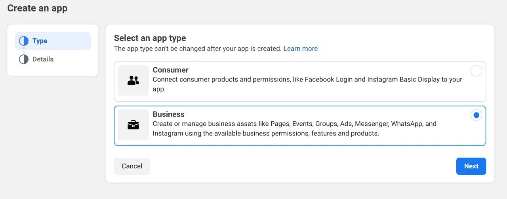
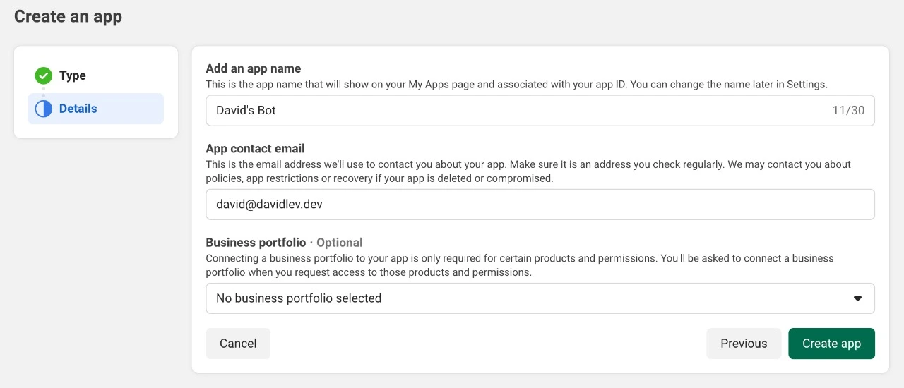
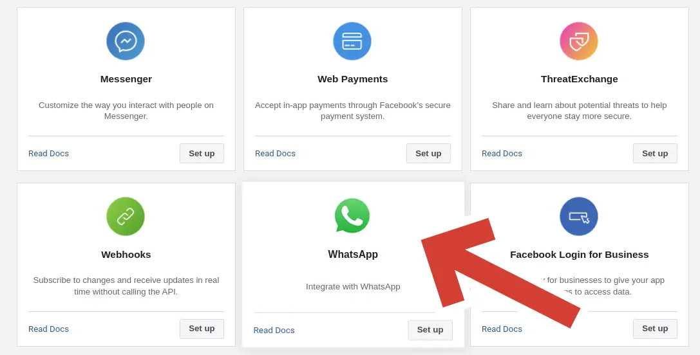
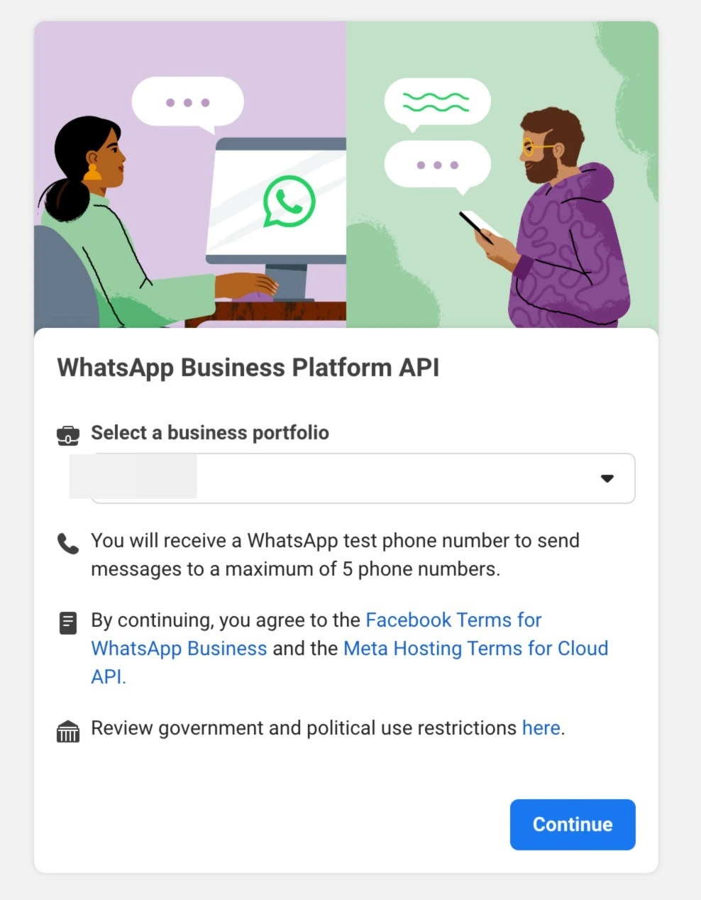
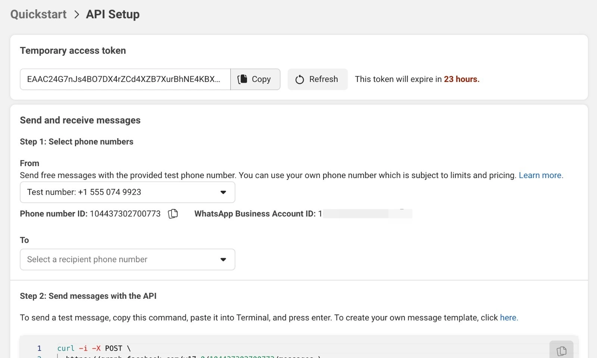
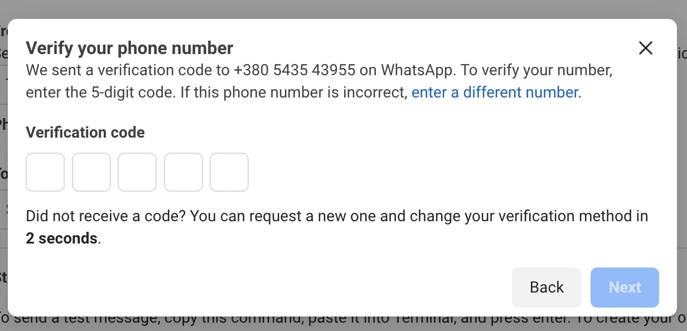

# ⚙️ Get Started

This page walks you through installing pywa, creating a WhatsApp app on Meta, and sending your first message. If you already have your **Phone ID** and **Token**, jump straight to `Send a Message <gs-send-message>`.

## ⬇️ Installation

- **Install using pip:**


```bash
pip3 install -U pywa
```


- **Install from source (bleeding edge):**


```bash
git clone https://github.com/david-lev/pywa.git
cd pywa && pip3 install -U .
```


- **For webhook features:**


```bash
pip3 install -U "pywa[server]"
```


- **For Flow features with default encryption/decryption:**


```bash
pip3 install -U "pywa[cryptography]"
```


----------------------------------------------------------------------------------------------------------------------------------------------------------------------------------------------------------------------------------------------------------------------------------------------------------------------------------------------------------------------------------------------------------------------------------------------------------------------------------------------------------------------------------------------------------------------------------------------------------------------------------------------------------------------------------------------------------------------------------------------------------------------------------------------------------------------------------------------------------------------------------------------------------------------------------------------------------------------------------------------------------------------------------------

## Create a WhatsApp Application

Already have a Facebook App? `Jump to Setup the App → <gs-setup-app>`

To use the WhatsApp Cloud API, you need a Facebook App. If you don't have a Facebook Developer account, [register here](https://developers.facebook.com/).

1.  Go to [Meta for Developers \> My Apps](https://developers.facebook.com/apps/) and create a new app.
    - Or click [here](https://developers.facebook.com/apps/create/?show_additional_prod_app_info=false) to go directly to the app creation page.
2.  Select **Business** as the app type and click **Next**.


??? example "Show"

    


3.  Fill in the app name and email, then click **Create App**.


??? example "Show"

    


4.  In **Add products to your app**, search for **WhatsApp** and click **Set Up**.


??? example "Show"

    


5.  Select a **Meta Business Account**, accept the terms, and click **Submit**. If you don't have a Business Account, you will need to create one.


??? example "Show"

    


----------------------------------------------------------------------------------------------------------------------------------------------------------------------------------------------------------------------------------------------------------------------------------------------------------------------------------------------------------------------------------------------------------------------------------------------------------------------------------------------------------------------------------------------------------------------------------------------------------------------------------------------------------------------------------------------------------------------------------------------------------------------------------------------------------------------------------------------------------------------------------------------------------------------------------------------------------------------------------------------------------------------------------------

## Setup the App

Already have your **Phone ID** and **Token**? `Jump to Send a Message → <gs-send-message>`

6.  In the left menu (under **Products**), expand **WhatsApp** and click **API Setup**.


??? example "Show"

    


- Copy the **Temporary access token** (valid for 24h) and the **Phone number ID**.


!!! note

    Note


    Learn [how to create a permanent token](https://developers.facebook.com/docs/whatsapp/business-management-api/get-started).


!!! warning

    Attention


    If you haven't connected a real phone number, you can use a test number provided by Meta. You can send messages to up to 5 allowed numbers. Add them in the **Manage phone number list**.


    ??? example "Show"

        


----------------------------------------------------------------------------------------------------------------------------------------------------------------------------------------------------------------------------------------------------------------------------------------------------------------------------------------------------------------------------------------------------------------------------------------------------------------------------------------------------------------------------------------------------------------------------------------------------------------------------------------------------------------------------------------------------------------------------------------------------------------------------------------------------------------------------------------------------------------------------------------------------------------------------------------------------------------------------------------------------------------------------------------

## Send a Message

Now that you have your `phone_id` and `token`, you're ready to send messages:


```python
from pywa import WhatsApp

wa = WhatsApp(
    phone_id="YOUR_PHONE_ID",  # from API Setup
    token="YOUR_TOKEN",  # from API Setup
)

# Send a text message
wa.send_message(
    to="PHONE_NUMBER_TO_SEND_TO", text="Hi! This message was sent from pywa!"
)

# Send an image
wa.send_image(
    to="PHONE_NUMBER_TO_SEND_TO",
    image="https://www.rd.com/wp-content/uploads/2021/04/GettyImages-1053735888-scaled.jpg",
)
```


!!! note

    Note


    - For **Test Numbers**, add recipients to the allowed numbers list.
    - Free-form messages can only be received if the recipient messaged your number in the last 24h. See [WhatsApp policy](https://business.whatsapp.com/policy).


----------------------------------------------------------------------------------------------------------------------------------------------------------------------------------------------------------------------------------------------------------------------------------------------------------------------------------------------------------------------------------------------------------------------------------------------------------------------------------------------------------------------------------------------------------------------------------------------------------------------------------------------------------------------------------------------------------------------------------------------------------------------------------------------------------------------------------------------------------------------------------------------------------------------------------------------------------------------------------------------------------------------------------------

## Quick Start

Here's a brief overview of the main pywa concepts — click any link to dive deeper:

- [WhatsApp](client/index.md): The core client. Use it to send messages, manage your business profile, and register handlers. Everything starts here.
- [Handlers](handlers/index.md): Register callbacks that fire when a user sends a message, presses a button, or triggers any other update. The backbone of every bot.
- [Listeners](listeners/index.md): Wait for a user's *next* reply inline, without registering a separate handler. Perfect for step-by-step conversations.
- [Filters](filters/index.md): Composable conditions that decide which updates a handler processes. Combine them with `&`, `|`, and `~` like Python expressions.
- [Updates](updates/index.md): All the types of incoming events — messages, button clicks, delivery statuses, flow completions, and more.
- [Flows](flows/index.md): Build rich, multi-screen interactive WhatsApp experiences entirely in Python.
- [Errors](errors/index.md): How pywa surfaces API errors and how to handle them gracefully.
- [Examples](examples/index.md): Complete, runnable bots and code snippets to get inspired.
