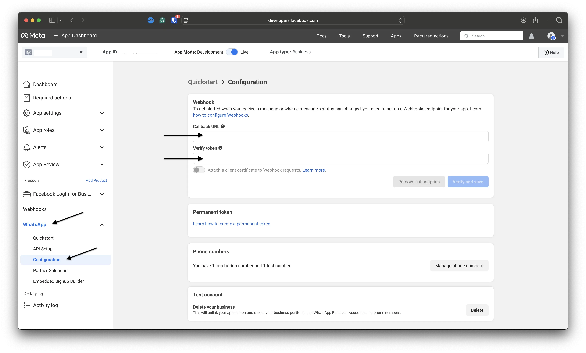
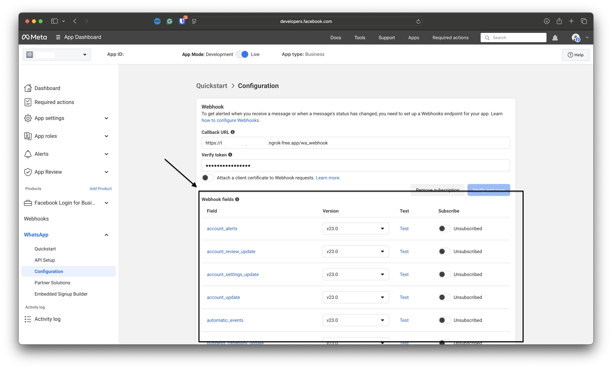

# 🎛️ Handlers

Handlers are where your bot reacts to incoming WhatsApp updates.

In pywa, every incoming webhook update is converted into a typed update object, such as [`Message`][pywa.types.message.Message], [`CallbackButton`][pywa.types.callback.CallbackButton], or [`MessageStatus`][pywa.types.message_status.MessageStatus]. You register callback functions for the update types you care about, and pywa calls the right function when WhatsApp sends an update.

The usual workflow is:

1.  Create a [`WhatsApp`][pywa.client.WhatsApp] client.
2.  Register handlers with decorators or `Handler` objects.
3.  Give WhatsApp a public callback URL.
4.  Run the app with `pywa dev` while developing, or `pywa run` for production.

This guide starts with the day-to-day part: writing handlers.

## Your First Handler

A handler callback receives the WhatsApp client and the update object.


```python title="main.py" linenums="1" hl_lines="9-11"
from pywa import WhatsApp, filters, types

wa = WhatsApp(
    phone_id="1234567890",
    token="EAA...",
    verify_token="my-verify-token",
)


@wa.on_message(filters.text)
def echo(client: WhatsApp, msg: types.Message):
    msg.reply(f"You said: {msg.text}")
```


Then run the file with the pywa CLI:


```bash title="Terminal"
pywa dev
```


`pywa dev` starts the webhook server and reloads it when your code changes.

## Registering Handlers

You can register handlers in two main ways:

- Decorators, which are the simplest option for most projects.
- `*Handler` objects, which are useful when handlers are assembled dynamically.

### Using decorators

Use the `on_...` decorators on your [`WhatsApp`][pywa.client.WhatsApp] client.


```python title="main.py" linenums="1" hl_lines="5 9"
from pywa import WhatsApp, types

wa = WhatsApp(...)


@wa.on_message
def handle_message(client: WhatsApp, msg: types.Message):
    print(msg)


@wa.on_callback_button
def handle_callback_button(client: WhatsApp, clb: types.CallbackButton):
    clb.react("❤️")
```


You can pass filters to the handlers:


```python title="main.py" linenums="1" hl_lines="5 9"
from pywa import WhatsApp, filters, types

wa = WhatsApp(...)


@wa.on_message(filters.text)
def handle_text_message(client: WhatsApp, msg: types.Message):
    msg.reply(f"You said: {msg.text}")


@wa.on_message(filters.image | filters.video)
def handle_media_message(client: WhatsApp, msg: types.Message):
    msg.reply(f"Thanks for sending a media message.")
```


See the [filters guide](../filters/index.md) for built-in filters and custom filters.

### Loading handlers from modules

If your handlers live in another module and do not have direct access to the client instance, register them on the [`WhatsApp`][pywa.client.WhatsApp] **class**:


```python title="my_handlers.py" linenums="1" hl_lines="3"
from pywa import WhatsApp, filters, types


@WhatsApp.on_message(filters.text)  # Register on the class, not an instance
def handle_text(client: WhatsApp, msg: types.Message):
    msg.reply(msg.text)
```


Then load that module when creating the client:


```python title="main.py" linenums="1" hl_lines="2 6"
from pywa import WhatsApp
from . import my_handlers  # Import the module that holds the handlers

wa = WhatsApp(
    ...,
    handlers_modules=[
        my_handlers,
    ],  # Pass the module to load handlers from it
)
```


You can also load modules later:


```python
wa.load_handlers_modules(my_handlers)
```


### Dynamic Handler Registration

You can register and remove handlers dynamically at runtime instead of declaring them all at startup. This is useful for state-dependent workflows (e.g., toggling a temporary maintenance mode) where handlers are added or removed on the fly.

To register a handler dynamically, instantiate one of the Available Handlers and pass it to [`add_handlers()`][pywa.client.WhatsApp.add_handlers]. To stop listening, pass the same handler instance to [`remove_handlers()`][pywa.client.WhatsApp.remove_handlers].

Here is an example demonstrating how to register a high-priority maintenance handler and dynamically remove it:


```python title="main.py" linenums="1" hl_lines="13-16 23 26"
from pywa import WhatsApp, filters, handlers, types

wa = WhatsApp(...)

admin_filter = filters.from_users("1234567890", "9876543210")


# Define a high-priority handler callback that intercepts messages during maintenance
def maintenance_callback(client: WhatsApp, msg: types.Message):
    msg.reply("🛠️ The bot is currently undergoing maintenance. Please try again later.")
    msg.stop_handling()  # Prevent other, lower-priority handlers from running


# Create the handler instance with high priority
maintenance_handler = handlers.MessageHandler(
    callback=maintenance_callback,
    filters=~admin_filter,  # Only non-admins
    priority=100,
)


# Handler to turn maintenance mode ON or OFF
@wa.on_message(filters.command("maintenance") & admin_filter)
def enable_maintenance(client: WhatsApp, msg: types.Message):
    if msg.text.split("maintenance")[1].strip() == "on":
        client.add_handlers(maintenance_handler)
        msg.reply("Maintenance mode has been activated.")
    else:
        client.remove_handlers(maintenance_handler, silent=True)
        msg.reply("Maintenance mode has been deactivated.")
```


## Available Handlers

| Decorator     | Handler       | Update type   |
|---------------|---------------|---------------|
| [`on_message()`][pywa.handlers._HandlerDecorators.on_message] | [`MessageHandler`][pywa.handlers.MessageHandler] | [`Message`][pywa.types.message.Message] |
| [`on_callback_button()`][pywa.handlers._HandlerDecorators.on_callback_button] | [`CallbackButtonHandler`][pywa.handlers.CallbackButtonHandler] | [`CallbackButton`][pywa.types.callback.CallbackButton] |
| [`on_callback_selection()`][pywa.handlers._HandlerDecorators.on_callback_selection] | [`CallbackSelectionHandler`][pywa.handlers.CallbackSelectionHandler] | [`CallbackSelection`][pywa.types.callback.CallbackSelection] |
| [`on_flow_completion()`][pywa.handlers._HandlerDecorators.on_flow_completion] | [`FlowCompletionHandler`][pywa.handlers.FlowCompletionHandler] | [`FlowCompletion`][pywa.types.flows.FlowCompletion] |
| [`on_flow_request()`][pywa.handlers._HandlerDecorators.on_flow_request] | [`FlowRequestHandler`][pywa.handlers.FlowRequestHandler] | [`FlowRequest`][pywa.types.flows.FlowRequest] |
| [`on_message_status()`][pywa.handlers._HandlerDecorators.on_message_status] | [`MessageStatusHandler`][pywa.handlers.MessageStatusHandler] | [`MessageStatus`][pywa.types.message_status.MessageStatus] |
| [`on_template_status_update()`][pywa.handlers._HandlerDecorators.on_template_status_update] | [`TemplateStatusUpdateHandler`][pywa.handlers.TemplateStatusUpdateHandler] | [`TemplateStatusUpdate`][pywa.types.templates.TemplateStatusUpdate] |
| [`on_template_category_update()`][pywa.handlers._HandlerDecorators.on_template_category_update] | [`TemplateCategoryUpdateHandler`][pywa.handlers.TemplateCategoryUpdateHandler] | [`TemplateCategoryUpdate`][pywa.types.templates.TemplateCategoryUpdate] |
| [`on_template_quality_update()`][pywa.handlers._HandlerDecorators.on_template_quality_update] | [`TemplateQualityUpdateHandler`][pywa.handlers.TemplateQualityUpdateHandler] | [`TemplateQualityUpdate`][pywa.types.templates.TemplateQualityUpdate] |
| [`on_template_components_update()`][pywa.handlers._HandlerDecorators.on_template_components_update] | [`TemplateComponentsUpdateHandler`][pywa.handlers.TemplateComponentsUpdateHandler] | [`TemplateComponentsUpdate`][pywa.types.templates.TemplateComponentsUpdate] |
| [`on_phone_number_change()`][pywa.handlers._HandlerDecorators.on_phone_number_change] | [`PhoneNumberChangeHandler`][pywa.handlers.PhoneNumberChangeHandler] | [`PhoneNumberChange`][pywa.types.system.PhoneNumberChange] |
| [`on_identity_change()`][pywa.handlers._HandlerDecorators.on_identity_change] | [`IdentityChangeHandler`][pywa.handlers.IdentityChangeHandler] | [`IdentityChange`][pywa.types.system.IdentityChange] |
| [`on_call_connect()`][pywa.handlers._HandlerDecorators.on_call_connect] | [`CallConnectHandler`][pywa.handlers.CallConnectHandler] | [`CallConnect`][pywa.types.calls.CallConnect] |
| [`on_call_terminate()`][pywa.handlers._HandlerDecorators.on_call_terminate] | [`CallTerminateHandler`][pywa.handlers.CallTerminateHandler] | [`CallTerminate`][pywa.types.calls.CallTerminate] |
| [`on_call_status()`][pywa.handlers._HandlerDecorators.on_call_status] | [`CallStatusHandler`][pywa.handlers.CallStatusHandler] | [`CallStatus`][pywa.types.calls.CallStatus] |
| [`on_call_permission_update()`][pywa.handlers._HandlerDecorators.on_call_permission_update] | [`CallPermissionUpdateHandler`][pywa.handlers.CallPermissionUpdateHandler] | [`CallPermissionUpdate`][pywa.types.calls.CallPermissionUpdate] |
| [`on_user_marketing_preferences()`][pywa.handlers._HandlerDecorators.on_user_marketing_preferences] | [`UserMarketingPreferencesHandler`][pywa.handlers.UserMarketingPreferencesHandler] | [`UserMarketingPreferences`][pywa.types.user_preferences.UserMarketingPreferences] |
| [`on_edited_message()`][pywa.handlers._HandlerDecorators.on_edited_message] | [`EditedMessageHandler`][pywa.handlers.EditedMessageHandler] | [`EditedMessage`][pywa.types.message.EditedMessage] |
| [`on_deleted_message()`][pywa.handlers._HandlerDecorators.on_deleted_message] | [`DeletedMessageHandler`][pywa.handlers.DeletedMessageHandler] | [`DeletedMessage`][pywa.types.message.DeletedMessage] |
| [`on_outgoing_message()`][pywa.handlers._HandlerDecorators.on_outgoing_message] | [`OutgoingMessageHandler`][pywa.handlers.OutgoingMessageHandler] | [`OutgoingMessage`][pywa.types.message.OutgoingMessage] |
| [`on_outgoing_edited_message()`][pywa.handlers._HandlerDecorators.on_outgoing_edited_message] | [`OutgoingEditedMessageHandler`][pywa.handlers.OutgoingEditedMessageHandler] | [`OutgoingEditedMessage`][pywa.types.message.OutgoingEditedMessage] |
| [`on_outgoing_deleted_message()`][pywa.handlers._HandlerDecorators.on_outgoing_deleted_message] | [`OutgoingDeletedMessageHandler`][pywa.handlers.OutgoingDeletedMessageHandler] | [`OutgoingDeletedMessage`][pywa.types.message.OutgoingDeletedMessage] |
| [`on_account_update()`][pywa.handlers._HandlerDecorators.on_account_update] | [`AccountUpdateHandler`][pywa.handlers.AccountUpdateHandler] | [`AccountUpdate`][pywa.types.account_update.AccountUpdate] |
| [`on_raw_update()`][pywa.handlers._HandlerDecorators.on_raw_update] | [`RawUpdateHandler`][pywa.handlers.RawUpdateHandler] | [`RawUpdate`][pywa.types.base_update.RawUpdate] |

## Handlers or Listeners?

Handlers are best for app entry points: commands, buttons, statuses, template events, and other updates that start a unit of work.

When you need to continue a conversation and wait for the user's next message, use a listener.


```python title="main.py" linenums="1" hl_lines="7"
from pywa import WhatsApp, filters, types

wa = WhatsApp(...)


@wa.on_message(filters.command("start"))
def start(client: WhatsApp, msg: types.Message):
    age = msg.reply("Hello! What's your age?").wait_for_reply(filters.text).text
    msg.reply(f"Nice, you are {age}.")
```


Read more in the [listeners guide](../listeners/index.md).

## Making WhatsApp Reach Your App

WhatsApp sends updates to a public HTTPS callback URL. During local development, that usually means opening a tunnel from the internet to your local server.

Pywa provides [`start_ngrok_tunnel()`][pywa.utils.start_ngrok_tunnel] for this:


```python title="main.py" linenums="1" hl_lines="1 3-7 14"
from pywa import WhatsApp, filters, types, utils

callback_url = utils.start_ngrok_tunnel(
    port=8000,
    auth_token="your-ngrok-auth-token",
    domain="subdomain.ngrok-free.app",
)

wa = WhatsApp(
    phone_id="1234567890",
    token="EAA...",
    app_id="1234567890",
    app_secret="xxxx",
    callback_url=callback_url,
    verify_token="my-verify-token",
)


@wa.on_message(filters.text)
def echo(client: WhatsApp, msg: types.Message):
    msg.reply(msg.text)
```


Run the app:


```bash title="Terminal"
pywa dev
```


Install the `ngrok` package before using the helper:


```bash title="Terminal"
pip install ngrok
```


!!! tip

    Tip


    Use a static ngrok domain while developing. It keeps the callback URL stable across restarts. After the first successful registration, you can usually comment out `callback_url` to avoid registering the same webhook every time you restart the app.


You can also use any other HTTPS tunnel or deployed URL, such as:

- [Cloudflare Tunnel](https://developers.cloudflare.com/cloudflare-one/connections/connect-networks/)
- [localtunnel](https://localtunnel.github.io/www/)
- Your production server URL

## Registering the Callback URL

WhatsApp must know where to send webhook requests. You can register the callback URL automatically with pywa or manually in the Meta app dashboard.

### Automatic registration

Automatic registration is the easiest option for development and for most apps.

Pass `callback_url` and `verify_token` to [`WhatsApp`][pywa.client.WhatsApp]. For the default app-level registration, also pass `app_id` and `app_secret`.


```python title="main.py" linenums="1" hl_lines="7-9"
from pywa import WhatsApp, utils

wa = WhatsApp(
    phone_id="1234567890",
    token="EAA...",
    app_id="1234567890",
    app_secret="xxxx",
    callback_url=utils.start_ngrok_tunnel(domain="subdomain.ngrok-free.app"),
    verify_token="my-verify-token",
)
```


When the server starts, pywa registers the URL and handles WhatsApp's verification challenge for you.

By default, pywa registers the URL in the app scope. You can use another scope with `callback_url_scope`:


```python title="main.py" linenums="1" hl_lines="7-8"
from pywa import WhatsApp, utils

wa = WhatsApp(
    phone_id="1234567890",
    token="EAA...",
    verify_token="my-verify-token",
    callback_url="https://example.com",
    callback_url_scope=utils.CallbackURLScope.PHONE,
)
```


The required IDs depend on the scope:

| Scope                    | Registers                             | Required values           |
|--------------------------|---------------------------------------|---------------------------|
| `CallbackURLScope.APP`   | The app webhook subscription          | `app_id` and `app_secret` |
| `CallbackURLScope.WABA`  | A WABA alternate callback URL         | `waba_id`                 |
| `CallbackURLScope.PHONE` | A phone-number alternate callback URL | `phone_id`                |

### Manual registration

If you prefer to register the URL yourself:

1.  Create the client with the same `verify_token` you will enter in Meta.
2.  Start the app so pywa can answer the verification challenge.
3.  Open **App Dashboard \> WhatsApp \> Configuration**.
4.  Enter your public callback URL and verify token.




```python title="main.py" linenums="1" hl_lines="5"
from pywa import WhatsApp

wa = WhatsApp(
    token="EAA...",
    verify_token="my-verify-token",
)
```


## Subscribing to Webhook Fields

When registering manually, make sure your app is subscribed to the webhook fields you need.

Go to **App Dashboard \> WhatsApp \> Configuration** and scroll to **Webhook Fields**.



Pywa can process these fields:

- `messages` - user messages, callbacks, and message statuses
- `calls` - call connect, terminate, and status updates
- `message_template_status_update` - template approval or rejection updates
- `message_template_quality_update` - template quality score updates
- `message_template_components_update` - template component updates
- `template_category_update` - template category changes
- `user_preferences` - user marketing preferences
- `account_update` - account update events

If you register the callback URL automatically, pywa subscribes to the webhook fields it supports. You can customize the fields with `webhook_fields`.

Use [`on_raw_update()`][pywa.handlers._HandlerDecorators.on_raw_update] if you want to receive unsupported webhook events yourself.

## Running pywa

After handlers and callback settings are in place, run the server.

### Using the CLI (recommended)

Install the server extras:


```bash title="Terminal"
pip install "pywa[server]"
```


Use `pywa dev` while developing:


```bash title="Terminal"
pywa dev
```


Use `pywa run` when you want to run without auto-reload:


```bash title="Terminal"
pywa run main.py
```


Both commands run pywa's built-in Starlette application with Uvicorn and register the webhook endpoint automatically.

You can also point the CLI to a specific client object:


```bash title="Terminal"
pywa dev main:wa2
pywa run --app wa2
```


Common options include:


```bash title="Terminal"
pywa dev --reload-dir src
pywa run --workers 4
```


### Using `WhatsApp.run()`

For quick scripts and prototypes, you can start the built-in server directly from Python:


```python title="main.py" linenums="1" hl_lines="7"
from pywa import WhatsApp

wa = WhatsApp(...)

# Register handlers here

wa.run()
```


This uses the same Starlette-based webhook app, but it is blocking and does not include the development features of `pywa dev`. Prefer `pywa dev` and `pywa run` for normal use.

### Using FastAPI or Flask

If your project already has a FastAPI or Flask app, pass it to `server`. Pywa registers the webhook routes on that app, and you run the app yourself.

FastAPI:


```python title="main.py" linenums="1" hl_lines="4 8-9 18-21"
from fastapi import FastAPI
from pywa import WhatsApp, filters, types

app = FastAPI()

wa = WhatsApp(
    ...,
    server=app,  # Pass your FastAPI or Flask app here
    webhook_endpoint="/whatsapp",  # Use different endpoint from "/" to avoid conflicts with your own routes
)


@wa.on_message(filters.text)
def echo(client: WhatsApp, msg: types.Message):
    msg.reply(msg.text)


# Serve your own routes alongside pywa's webhook
@app.get("/")
def read_root():
    return {"Hello": "World"}
```


Run FastAPI normally:


```bash title="Terminal"
fastapi dev main.py
```


Flask works the same way:


```python title="app.py" linenums="1" hl_lines="4 8-9 17"
from flask import Flask
from pywa import WhatsApp, filters, types

app = Flask(__name__)

wa = WhatsApp(
    ...,
    server=app,
    webhook_endpoint="/whatsapp",
)


@wa.on_message(filters.text)
def echo(client: WhatsApp, msg: types.Message):
    msg.reply(msg.text)


if __name__ == "__main__":
    app.run(port=8000)
```


If you pass a custom FastAPI or Flask server, pywa does not run it for you.

## Handler Order and Flow

By default, pywa stops after the first handler whose **filter** matches an update.


```python title="main.py" linenums="1"
from pywa import WhatsApp, types

wa = WhatsApp(...)


@wa.on_message
def first(client: WhatsApp, msg: types.Message):
    print("first")  # <-- runs, then stops. second() is never called.


@wa.on_message
def second(client: WhatsApp, msg: types.Message):
    print("second")  # <-- never reached, because first() matched first.
```


Handlers run in registration order unless you set `priority`. **Higher priority number runs first** — a handler with `priority=2` runs before one with `priority=1`.


```python title="main.py" linenums="1" hl_lines="5 9"
from pywa import WhatsApp, types

wa = WhatsApp(...)


@wa.on_message(priority=1)
def first(client: WhatsApp, msg: types.Message):
    print("First:", msg)


@wa.on_message(priority=2)
def second(client: WhatsApp, msg: types.Message):
    print("Second:", msg)
```


To keep checking later handlers by default, enable `continue_handling`:


```python title="main.py" linenums="1"
wa = WhatsApp(..., continue_handling=True)
```


You can also control the flow from inside a handler with [`stop_handling()`][pywa.types.base_update.BaseUpdate.stop_handling] and [`continue_handling()`][pywa.types.base_update.BaseUpdate.continue_handling].


```python title="main.py" linenums="1" hl_lines="8 10"
from pywa import WhatsApp, filters, types

wa = WhatsApp(...)


@wa.on_message(filters.text)
def handle_message(client: WhatsApp, msg: types.Message):
    if msg.text == "stop":
        msg.stop_handling()
    else:
        msg.continue_handling()
```


## Validating Updates

WhatsApp [recommends](https://developers.facebook.com/docs/graph-api/webhooks/getting-started#event-notifications) validating incoming webhook requests with the `X-Hub-Signature-256` header.

Pywa validates updates by default when `app_secret` is provided:


```python title="main.py" linenums="1" hl_lines="4 5"
from pywa import WhatsApp

wa = WhatsApp(
    app_secret="xxxx",
    validate_updates=True,
    ...
)
```


If no `app_secret` is provided, pywa disables validation and emits a warning. If validation is enabled and the signature is missing or invalid, pywa rejects the request before calling your handlers. You can disable validation explicitly with `validate_updates=False`.

## Using Other Web Frameworks

FastAPI and Flask are registered automatically. For any other web framework, create the HTTP routes yourself and call pywa's webhook helper methods.

Your framework needs two routes on the same endpoint:

- `GET` for the verification challenge.
- `POST` for incoming webhook updates.

Verification route:


```python title="main.py" linenums="1"
challenge, status = wa.webhook_challenge_handler(
    vt=request.GET[utils.HUB_VT],
    ch=request.GET[utils.HUB_CH],
)

return challenge, status
```


Update route:


```python title="main.py" linenums="1"
body = request.body

validation_error = wa.webhook_update_validator(
    update=body,
    hmac_header=request.headers.get(utils.HUB_SIG),
)

if validation_error:
    return validation_error

response, status = wa.webhook_update_handler(update=body)
return response, status
```


With manual framework integration, you are responsible for returning the right response format for your framework and for running the server.


!!! note

    Note


    Regardless of how you run pywa (`pywa dev`, `pywa run`, or [`run()`][pywa.server.Server.run]), it creates a small Starlette app backed by Uvicorn and registers two routes on `webhook_endpoint`:

    - `GET` — answers WhatsApp's verification challenge.
    - `POST` — receives and dispatches incoming webhook updates.

    When you pass a FastAPI or Flask `server`, pywa registers the same routes on that app instead. For any other framework, use the `manual helper methods <Using Other Web Frameworks>` above.


!!! tip

    Tip


    **Common best practices:**

    - Always add a filter (e.g., `filters.text`) to message handlers that read `msg.text` so the handler is never called with `None`.
    - Avoid long blocking operations inside synchronous handlers — they block the entire event loop. Use threads or switch to `pywa_async` for async handlers.
    - Use `priority` sparingly. Explicit filters are usually cleaner than execution ordering.
    - Use `shared_data` on the update object to pass context between chained handlers instead of global state.

- [Handler Decorators](handler_decorators.md)
- [Handler Objects](handler_objects.md)
