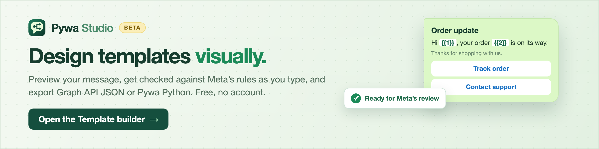
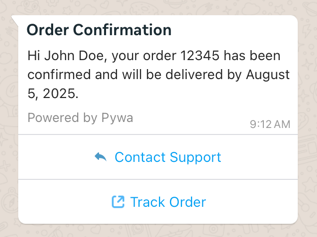
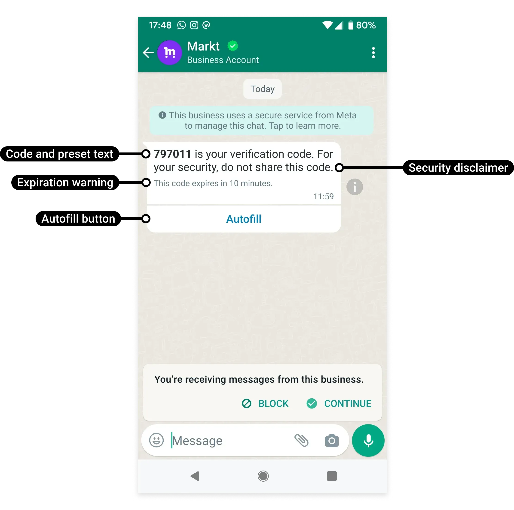
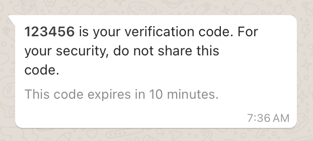
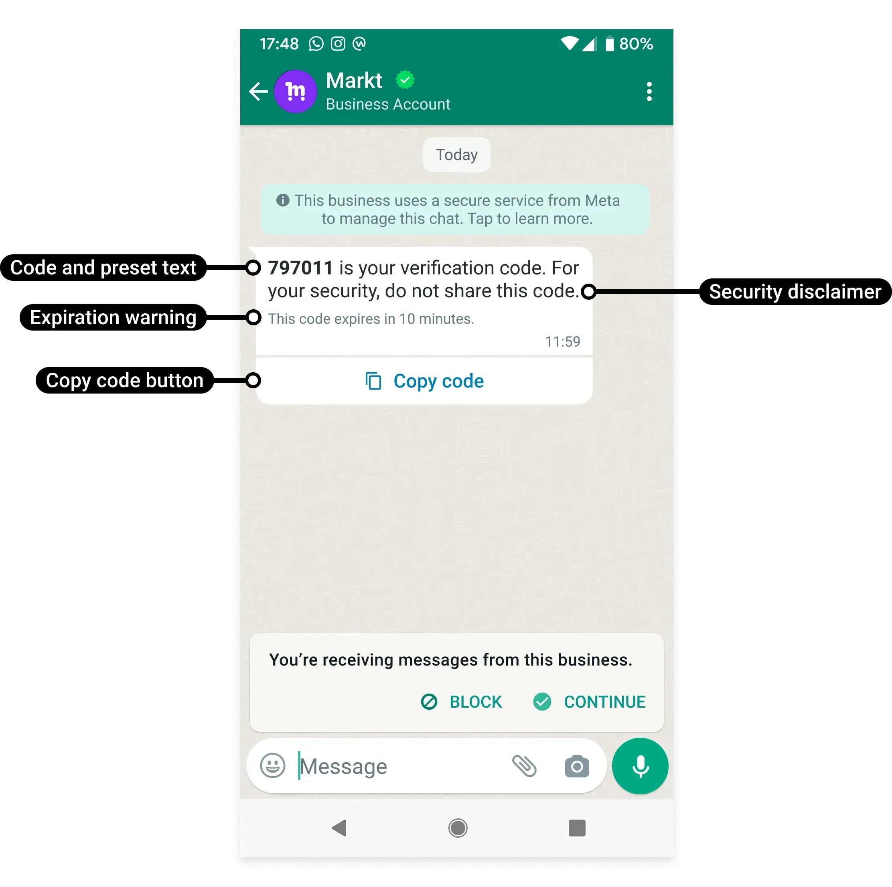
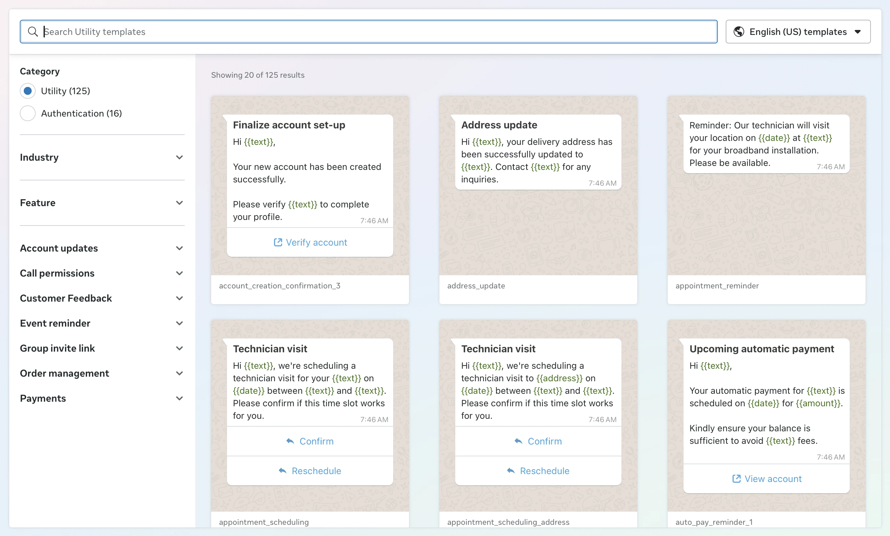

# 📄 Templates

In the realm of WhatsApp messaging, templates serve as pre-approved message structures that businesses can use to initiate conversations with users. These templates are essential for sending notifications, updates, or any message that requires prior approval from WhatsApp.

Think of templates as reusable message blueprints that ensure your communications are consistent, compliant, and ready to engage your audience. They can include various components such as headers, bodies, footers, and buttons, allowing for rich and interactive messages.

[](https://studio.pywa.cloud/templates)

PyWa offers a comprehensive and intuitive interface to create, manage, and send these templates seamlessly. Whether you're looking to send promotional offers, account updates, or authentication codes, PyWa's templating system ensures your messages are structured, consistent, and compliant with WhatsApp's guidelines.

- From [developers.facebook.com](https://developers.facebook.com/docs/whatsapp/business-management-api/message-templates):

  > Templates are WhatsApp Business Account assets that can be sent in template messages via Cloud API or Marketing Messages Lite API. Template messages are the only type of message that can be sent to WhatsApp users outside of a [customer service window](https://developers.facebook.com/docs/whatsapp/cloud-api/guides/send-messages/#customer-service-windows), so templates are commonly used when messaging users in bulk, or when you need to message a user, but no customer service window is open between you and the user.

## Defining Template

To create a template, you need to define its structure using the [`Template`][pywa.types.templates.Template] class from the `pywa.types.templates` module. This involves specifying the template's name, language, category, parameter format, and the components that make up the template.

In the example below, we create a simple Order Confirmation template with a header, body, footer, and buttons.


```python title="order_confirmation_template.py" linenums="1"
from pywa.types.templates import *

order_confirmation = Template(
    name="order_confirmation",
    language=TemplateLanguage.ENGLISH_US,
    category=TemplateCategory.MARKETING,
    parameter_format=ParamFormat.NAMED,
    components=[
        HeaderText(text="Order Confirmation"),
        BodyText(
            "Hi {{name}}, your order {{order_id}} has been confirmed and will be delivered by {{delivery_date}}.",
            name="John Doe",
            order_id=12345,
            delivery_date="August 5, 2025",
        ),
        Buttons(
            buttons=[
                QuickReplyButton(
                    text="Contact Support",
                ),
                URLButton(
                    text="Track Order",
                    url="https://www.example.com/track-order?order_id={{1}}",
                    example="12345",
                ),
            ]
        ),
        FooterText(text="Powered by Pywa"),
    ],
)
```


In this example, we define a template named "order_confirmation" in English (US) for marketing purposes. We use a named parameter format, allowing us to use descriptive names for our parameters like `name`, `order_id`, and `delivery_date` in the body text. The template includes a header with text, a body with dynamic parameters, buttons for quick replies and URLs, and a footer with additional information.





This is how the template will look in WhatsApp once sent.


## Template Components

| Category | Types                                                                                                                                                                                             |
|----------|---------------------------------------------------------------------------------------------------------------------------------------------------------------------------------------------------|
| Headers  | [`HeaderText`][pywa.types.templates.HeaderText], [`HeaderImage`][pywa.types.templates.HeaderImage], [`HeaderVideo`][pywa.types.templates.HeaderVideo], [`HeaderDocument`][pywa.types.templates.HeaderDocument], [`HeaderGIF`][pywa.types.templates.HeaderGIF], [`HeaderLocation`][pywa.types.templates.HeaderLocation], [`HeaderProduct`][pywa.types.templates.HeaderProduct]                                                                                           |
| Bodies   | [`BodyText`][pywa.types.templates.BodyText], [`AuthenticationBody`][pywa.types.templates.AuthenticationBody]                                                                                                                                                                      |
| Footers  | [`FooterText`][pywa.types.templates.FooterText], [`AuthenticationFooter`][pywa.types.templates.AuthenticationFooter]                                                                                                                                                                      |
| Buttons  | [`Buttons`][pywa.types.templates.Buttons], [`QuickReplyButton`][pywa.types.templates.QuickReplyButton], [`URLButton`][pywa.types.templates.URLButton], [`CopyCodeButton`][pywa.types.templates.CopyCodeButton], [`CatalogButton`][pywa.types.templates.CatalogButton], [`FlowButton`][pywa.types.templates.FlowButton], [`CallPermissionRequestButton`][pywa.types.templates.CallPermissionRequestButton], [`VoiceCallButton`][pywa.types.templates.VoiceCallButton], [`MPMButton`][pywa.types.templates.MPMButton], [`SPMButton`][pywa.types.templates.SPMButton], [`OneTapOTPButton`][pywa.types.templates.OneTapOTPButton], [`ZeroTapOTPButton`][pywa.types.templates.ZeroTapOTPButton], [`CopyCodeOTPButton`][pywa.types.templates.CopyCodeOTPButton] |
| Others   | [`Carousel`][pywa.types.templates.Carousel], [`LimitedTimeOffer`][pywa.types.templates.LimitedTimeOffer]                                                                                                                                                                      |

## Creating Template

After defining your template, you can create it using the [`create_template()`][pywa.client.WhatsApp.create_template] method:


```python title="create_template.py" linenums="1"
from pywa import WhatsApp

wa = WhatsApp(waba_id=...)

wa.create_template(order_confirmation)
# CreatedTemplate(id='...', category=TemplateCategory.MARKETING, status=TemplateStatus.PENDING)
```


After creating a template, you need to wait for WhatsApp to approve it. This process can take some time, and you can check the status of your template using the [`get_template()`][pywa.client.WhatsApp.get_template] method or by checking the [WhatsApp Manager Dashboard](https://business.facebook.com/latest/whatsapp_manager/) Manage templates.


!!! note

    Note


    You can also use the [`get_templates()`][pywa.client.WhatsApp.get_templates] method to retrieve a list of all templates associated with your business account.


You can also [`wait_until_approved()`][pywa.types.templates._CreatedAndUpdatedTemplateActions.wait_until_approved] for the template to be approved, which will block the execution until the template is approved or rejected.


```python title="wait_until_approved.py" linenums="1"
from pywa import WhatsApp

wa = WhatsApp(waba_id=...)

template = wa.create_template(order_confirmation)
template.wait_until_approved()
```


Or you can handle the template status using the [`on_template_status_update()`][pywa.handlers._HandlerDecorators.on_template_status_update] decorator, which allows you to define a callback function that will be called whenever the template status changes:


```python title="on_template_status_update.py" linenums="1"
from pywa import WhatsApp, types
from pywa.types import TemplateStatusUpdate
from pywa.types.templates import TemplateStatus

wa = WhatsApp(waba_id=..., token=...)


@wa.on_template_status_update
def handle_template_status_update(_: WhatsApp, update: TemplateStatusUpdate):
    if update.new_status == TemplateStatus.APPROVED:
        print(f"Template {update.template_id} approved!")
    elif update.new_status == TemplateStatus.REJECTED:
        print(f"Template {update.template_id} rejected: {update.reason}")
```


## Sending Template

Once your template is approved, you can send it using the [`send_template()`][pywa.client.WhatsApp.send_template] method.


```python title="send_template.py" linenums="1" hl_lines="10"
from pywa import WhatsApp
from pywa.types.templates import *

wa = WhatsApp(phone_id=..., token=...)

wa.send_template(
    to="972123456789",
    name="order_confirmation",
    language=TemplateLanguage.ENGLISH_US,
    params=[...],
)
```


Now, the `params` list should contain the values for the components defined in the template.

The best practice is to use the Template object you created earlier as a reference for the parameters, ensuring that the values match the expected format:


```python title="send_template_with_object.py" linenums="1" hl_lines="11 19 22 37 39-41"
from pywa import WhatsApp
from pywa.types.templates import *

order_confirmation = Template(
    name="order_confirmation",
    language=TemplateLanguage.ENGLISH_US,
    category=TemplateCategory.MARKETING,
    parameter_format=ParamFormat.NAMED,
    components=[
        HeaderText(text="Order Confirmation"),
        bdy := BodyText(
            "Hi {{name}}, your order {{order_id}} has been confirmed and will be delivered by {{delivery_date}}.",
            name="John Doe",
            order_id=12345,
            delivery_date="August 5, 2025",
        ),
        Buttons(
            buttons=[
                qrb := QuickReplyButton(
                    text="Contact Support",
                ),
                urlb := URLButton(
                    text="Track Order",
                    url="https://www.example.com/track-order?order_id={{1}}",
                    example="12345",
                ),
            ]
        ),
        FooterText(text="Powered by Pywa"),
    ],
)

wa = WhatsApp(phone_id=..., token=...)

wa.send_template(
    to="972123456789",
    template=order_confirmation,
    params=[
        bdy.params(
            name="Jane Doe",
            order_id=67890,
            delivery_date=DateTime(fallback_value="September 10, 2025"),
        ),
        qrb.params(callback_data="contact-support", index=0),
        urlb.params(url_variable="67890", index=1),
    ],
)
```


As you can see, we use the params method of each component to generate the parameters needed for the template.


!!! tip

    Tip


    Using `params` on the instance ensures that the parameters are correctly formatted and match the expected types, reducing the risk of errors when sending the template. But sometimes, you don't have access to the template components instances (e.g when creating using WhatsApp Manager Dashboard), and you need to create the parameters manually. In that case, you can still use the `params` method on each component to create the parameters directly, as shown below:


    ```python title="send_template_without_object.py" linenums="1" hl_lines="11-13"
    from pywa import WhatsApp
    from pywa.types.templates import *

    wa = WhatsApp(phone_id=..., token=...)

    wa.send_template(
        to="972123456789",
        name="order_confirmation",
        language=TemplateLanguage.ENGLISH_US,
        params=[
            BodyText.params(
                name="Jane Doe",
                order_id=67890,
                delivery_date=DateTime(fallback_value="September 10, 2025"),
            ),
            QuickReplyButton.params(callback_data="contact-support", index=0),
            URLButton.params(url_variable="67890", index=1),
        ],
    )
    ```


## Media Templates

When creating templates that include media, such as images, videos, or documents, you need to provide example of the media in the template definition. This is done using the example parameter in the media components.


!!! note

    Note


    Media examples automatically uploaded via the [Upload Resumable API](https://developers.facebook.com/docs/graph-api/guides/upload), this requires to provide `app_id` when initializing the WhatsApp client. If you don't provide the `app_id`, you will need to upload the media manually using the Upload Resumable API before creating the template and provide the file handle in the example parameter.


```python title="media_template.py" linenums="1" hl_lines="8"
from pywa.types.templates import *

media_template = Template(
    name="media_template",
    language=TemplateLanguage.ENGLISH_US,
    category=TemplateCategory.MARKETING,
    components=[
        HeaderImage(example="https://www.example.com/image-example.jpg"),
        BodyText(text="Check out our new product!"),
        FooterText(text="Visit our website for more details."),
    ],
)
```


The `example` parameter can be a URL, file path, [`Media`][pywa.types.media.Media] or bytes. This example media will be used by WhatsApp to verify the template and ensure it meets their guidelines.


!!! tip

    Tip


    PyWa uploads the media automatically when creating the template and caches the file handle (from Upload Resumable API) in the header object. This means that if you create multiple templates with the same media example - you may want to use the same media object to avoid uploading the same media multiple times. This will save you time and resources.


    ```python title="media_template_with_cache.py" linenums="1" hl_lines="8 16"
    from pywa import WhatsApp
    from pywa.types.media import Media
    from pywa.types.templates import *

    wa = WhatsApp(token=..., waba_id=..., app_id=...)

    image = pathlib.Path("path/to/image.jpg")
    header_image = HeaderImage(example=image)

    for lang in [
        TemplateLanguage.ENGLISH,
        TemplateLanguage.ENGLISH_US,
        TemplateLanguage.ENGLISH_UK,
    ]:
        media_template = Template(
            name="media_template",
            language=lang,
            category=TemplateCategory.MARKETING,
            components=[
                header_image,  # Reuse the same header image
                BodyText(text="Check out our new product!"),
                FooterText(text="Visit our website for more details."),
            ],
        )

        wa.create_template(media_template)
    ```


    The same goes for other media components ([`HeaderVideo`][pywa.types.templates.HeaderVideo] and [`HeaderDocument`][pywa.types.templates.HeaderDocument]), you can reuse the same media object across multiple templates to avoid uploading the same media multiple times.


When sending a media template, you can use the same approach as before, but now you need to provide the media as an parameter in the template:


```python title="send_media_template.py" linenums="1" hl_lines="6 16"
media_template = Template(
    name="media_template",
    language=TemplateLanguage.ENGLISH_US,
    category=TemplateCategory.MARKETING,
    components=[
        hi := HeaderImage(example="https://www.example.com/image-example.jpg"),
        BodyText(text="Check out our new product!"),
        FooterText(text="Visit our website for more details."),
    ],
)

wa.send_template(
    to="972123456789",
    template=media_template,
    params=[
        hi.params(image="https://www.my-cdn.com/image.jpg"),
    ],
)
```


!!! tip

    Tip


    If you are sending the same template multiple times, you can cache the media object and reuse it across multiple template sends. This will save you time and resources, as the media will not be uploaded again.


    ```python title="send_media_template_with_cache.py" linenums="1" hl_lines="11 17 24"
    from pywa import WhatsApp
    from pywa.types.templates import *

    wa = WhatsApp(token=..., waba_id=..., app_id=...)

    media_template = Template(
        name="media_template",
        language=TemplateLanguage.ENGLISH_US,
        category=TemplateCategory.MARKETING,
        components=[
            hi := HeaderImage(example="https://www.example.com/image-example.jpg"),
            BodyText(text="Check out our new product!"),
            FooterText(text="Visit our website for more details."),
        ],
    )

    hi_param = hi.params(image=pathlib.Path("path/to/image.jpg"))

    for phone_number in ["972123456789", "972987654321", "972456789123"]:
        wa.send_template(
            to=phone_number,
            name=media_template.name,
            language=media_template.language,
            params=[hi_param],  # Reuse the same header image parameter
        )
    ```


## Authentication Templates

Authentication templates are a special type of template used for sending authentication codes to users. If you need to send OTPs (One-Time Passwords) to users so they can verify their identity or complete a transaction in another app, you can use authentication templates.

Creating an authentication template is similar to creating a regular template, but it includes specific components for authentication, such as the [`AuthenticationBody`][pywa.types.templates.AuthenticationBody] and [`AuthenticationFooter`][pywa.types.templates.AuthenticationFooter].


```python title="authentication_template.py" linenums="1" hl_lines="6-15"
from pywa.types.templates import *

auth_template = Template(
    name="auth_code",
    language=TemplateLanguage.ENGLISH_US,
    category=TemplateCategory.AUTHENTICATION,
    components=[
        AuthenticationBody(add_security_recommendation=True),
        AuthenticationFooter(code_expiration_minutes=5),
        Buttons(
            buttons=[
                # An OTP Button
            ],
        ),
    ],
)
```


The OTP button can be one of the following types:

- [`OneTapOTPButton`][pywa.types.templates.OneTapOTPButton]: A button that allows the user to tap and automatically fill in the OTP code in the app:


  ```python title="one_tap_otp_button.py" linenums="1"
  from pywa.types.templates import *

  otp_button = OneTapOTPButton(
      text="Autofill Code",
      autofill_text="Autofill",
      supported_apps=[
          OTPSupportedApp(package_name="com.example.myapp", signature_hash="12345678901"),
      ],
  )
  ```





--

- [`ZeroTapOTPButton`][pywa.types.templates.ZeroTapOTPButton]: A button that allows the user to receive the OTP code without any interaction.


  ```python title="zero_tap_otp_button.py" linenums="1"
  from pywa.types.templates import *

  otp_button = ZeroTapOTPButton(
      text="Autofill Code",
      autofill_text="Autofill",
      zero_tap_terms_accepted=5,
      supported_apps=[
          OTPSupportedApp(package_name="com.example.myapp", signature_hash="12345678901"),
      ],
  )
  ```





--

- [`CopyCodeOTPButton`][pywa.types.templates.CopyCodeOTPButton]: A button that allows the user to copy the OTP code to the clipboard and use it in another app.


  ```python title="copy_code_otp_button.py" linenums="1"
  from pywa.types.templates import *

  otp_button = CopyCodeOTPButton()
  ```





--

When sending an authentication template you need to provide the OTP code as a parameter to the [`AuthenticationBody`][pywa.types.templates.AuthenticationBody] and to the OTP button you are using.


```python title="send_authentication_template.py" linenums="1" hl_lines="11-12"
from pywa import WhatsApp
from pywa.types.templates import *

wa = WhatsApp(phone_id=..., token=...)

wa.send_template(
    to="972123456789",
    name="auth_code",
    language=TemplateLanguage.ENGLISH_US,
    params=[
        AuthenticationBody.params(otp="123456"),
        OneTapOTPButton.params(otp="123456"),
    ],
)
```


!!! tip

    Tip


    Authentication templates texts are fixed and cannot be edited (except the button title), So WhatsApp allows you to create and update multiple authentication templates with the same name. This means you can create multiple authentication templates with the same name, but for different languages.

    To create an authentication template for multiple languages, you can use the [`upsert_authentication_template()`][pywa.client.WhatsApp.upsert_authentication_template] method, which allows you to create or update an authentication template for multiple languages at once.


    ```python title="create_authentication_template_multiple_languages.py" linenums="1"
    from pywa import WhatsApp
    from pywa.types.templates import *

    wa = WhatsApp(waba_id=..., token=...)

    templates = wa.upsert_authentication_template(
        name="one_tap_authentication",
        languages=[
            TemplateLanguage.ENGLISH_US,
            TemplateLanguage.FRENCH,
            TemplateLanguage.SPANISH,
        ],
        otp_button=OneTapOTPButton(supported_apps=...),
        add_security_recommendation=True,
        code_expiration_minutes=5,
    )
    for template in templates:
        print(f"Template {template.id} created with status {template.status}")
    ```


## Template Library

PyWa also provides an easy way to create templates from the Template Library. The library contains a collection of pre-defined templates that you can use to quickly create and send messages without having to define them from scratch.

From [developers.facebook.com](https://developers.facebook.com/docs/whatsapp/cloud-api/guides/send-message-templates/template-library):

> 
>
> Template Library makes it faster and easier for businesses to create utility templates for common use cases, like payment reminders, delivery updates — and authentication templates for common identity verification use cases.
>
> These pre-written templates have already been categorized as utility or authentication. Library templates contain fixed content that cannot be edited and parameters you can adapt for business or user-specific information.
>
> You can browse and create templates using Template Library in WhatsApp Manager, or programmatically via the API.

To create a template from the library, you need to get the template library name and pass it to the [`create_template()`][pywa.client.WhatsApp.create_template] method:


```python title="create_template_from_library.py" linenums="1"
from pywa import WhatsApp

wa = WhatsApp(waba_id=..., token=...)

# Define the template
order_update = LibraryTemplate(
    name="order_update",
    library_template_name="order_update_no_cta_1",
    category=TemplateCategory.UTILITY,
    language=TemplateLanguage.ENGLISH_US,
)

# Create the template
wa.create_template(order_update)
# CreatedTemplate(id='...', category=TemplateCategory.UTILITY, status=TemplateStatus.PENDING)
```


If the library template requires parameters, you need to provide them when creating the template. The parameters should match the ones defined in the library template:


```python title="create_template_from_library_with_params.py" linenums="1"
from pywa import WhatsApp
from pywa.types.templates import *

wa = WhatsApp(waba_id=..., token=...)

# Define the template with parameters
order_update = LibraryTemplate(
    name="order_update",
    library_template_name="order_update_1",
    category=TemplateCategory.UTILITY,
    language=TemplateLanguage.ENGLISH_US,
    library_template_button_inputs=[
        URLButton.library_input(
            base_url="https://www.example.com/track-order/{{1}}",
            url_suffix_example="https://www.example.com/track-order/12345",
        ),
    ],
)

# Create the template
wa.create_template(order_update)
# CreatedTemplate(id='...', category=TemplateCategory.UTILITY, status=TemplateStatus.PENDING)
```

- [Template Types](types.md)
