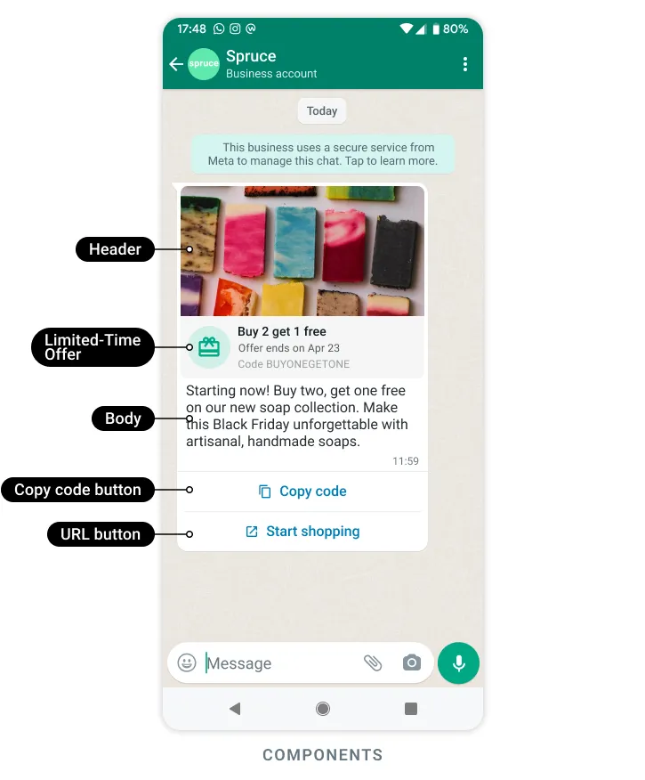

# Template Types

::: pywa.types.templates.Template
    options:
      members: ["get_component", "get_components", "validate_params"]
      inherited_members: ["get_component", "get_components", "validate_params"]

::: pywa.types.templates.TemplateDetails
    options:
      members: ["update", "duplicate", "delete", "compare", "send", "unpause", "get_component", "get_components", "validate_params"]
      inherited_members: ["update", "duplicate", "delete", "compare", "send", "unpause", "get_component", "get_components", "validate_params"]

::: pywa.types.templates.TemplateStatus
    options:
      members: false

::: pywa.types.templates.QualityScore
    options:
      members: false

::: pywa.types.templates.LibraryTemplate
    options:
      members: false

::: pywa.types.templates.TemplateCategory
    options:
      members: false

::: pywa.types.templates.TemplateLanguage
    options:
      members: false

::: pywa.types.templates.ParamFormat
    options:
      members: false

::: pywa.types.templates.HeaderText
    options:
      members: ["preview", "param_names", "params", "validate"]
      inherited_members: ["preview", "param_names", "params", "validate"]

::: pywa.types.templates.HeaderImage
    options:
      members: ["params"]
      inherited_members: ["params"]

::: pywa.types.templates.HeaderVideo
    options:
      members: ["params"]
      inherited_members: ["params"]

::: pywa.types.templates.HeaderDocument
    options:
      members: ["params"]
      inherited_members: ["params"]

::: pywa.types.templates.HeaderGIF
    options:
      members: ["params"]
      inherited_members: ["params"]

::: pywa.types.templates.HeaderLocation
    options:
      members: ["params"]
      inherited_members: ["params"]

::: pywa.types.templates.HeaderProduct
    options:
      members: ["params"]
      inherited_members: ["params"]

::: pywa.types.templates.BodyText
    options:
      members: ["preview", "param_names", "params", "library_input", "validate"]
      inherited_members: ["preview", "param_names", "params", "library_input", "validate"]

::: pywa.types.templates.DateTime
    options:
      members: false

::: pywa.types.templates.Currency
    options:
      members: false

::: pywa.types.templates.FooterText
    options:
      members: false

::: pywa.types.templates.Buttons
    options:
      members: false

::: pywa.types.templates.CopyCodeButton
    options:
      members: ["params"]
      inherited_members: ["params"]

::: pywa.types.templates.FlowButton
    options:
      members: ["params"]
      inherited_members: ["params"]

::: pywa.types.templates.FlowButtonIcon
    options:
      members: false

::: pywa.types.templates.PhoneNumberButton
    options:
      members: ["library_input"]
      inherited_members: ["library_input"]

::: pywa.types.templates.VoiceCallButton
    options:
      members: false

::: pywa.types.templates.CallPermissionRequestButton
    options:
      members: false

::: pywa.types.templates.ContactInfoRequestButton
    options:
      members: false

::: pywa.types.templates.QuickReplyButton
    options:
      members: ["params"]
      inherited_members: ["params"]

::: pywa.types.templates.URLButton
    options:
      members: ["params", "library_input"]
      inherited_members: ["params", "library_input"]

::: pywa.types.templates.AppDeepLink
    options:
      members: false

::: pywa.types.templates.CatalogButton
    options:
      members: ["params"]
      inherited_members: ["params"]

::: pywa.types.templates.MPMButton
    options:
      members: ["params"]
      inherited_members: ["params"]

::: pywa.types.templates.SPMButton
    options:
      members: false

::: pywa.types.templates.OneTapOTPButton
    options:
      members: ["params", "library_input"]
      inherited_members: ["params", "library_input"]

::: pywa.types.templates.ZeroTapOTPButton
    options:
      members: ["params", "library_input"]
      inherited_members: ["params", "library_input"]

::: pywa.types.templates.CopyCodeOTPButton
    options:
      members: ["params", "library_input"]
      inherited_members: ["params", "library_input"]

::: pywa.types.templates.OTPSupportedApp
    options:
      members: false

::: pywa.types.templates.LimitedTimeOffer
    options:
      members: ["params"]
      inherited_members: ["params"]

::: pywa.types.templates.Carousel
    options:
      members: ["params"]
      inherited_members: ["params"]

::: pywa.types.templates.CarouselCard
    options:
      members: ["params"]
      inherited_members: ["params"]

::: pywa.types.templates.TapTargetConfiguration
    options:
      members: false

::: pywa.types.templates.AuthenticationBody
    options:
      members: ["params", "library_input"]
      inherited_members: ["params", "library_input"]

::: pywa.types.templates.AuthenticationFooter
    options:
      members: false

::: pywa.types.templates.TemplatesResult
    options:
      members: false
      show_bases: true

::: pywa.types.templates.CreatedTemplate
    options:
      members: false

::: pywa.types.templates.CreatedTemplates
    options:
      members: false

::: pywa.types.templates.UpdatedTemplate
    options:
      members: false

::: pywa.types.templates.TemplateUnpauseResult
    options:
      members: false

::: pywa.types.templates.TemplatesCompareResult
    options:
      members: false

::: pywa.types.templates.TopBlockReasonType
    options:
      members: false

::: pywa.types.templates.MigrateTemplatesResult
    options:
      members: false

::: pywa.types.templates.MigratedTemplate
    options:
      members: false

::: pywa.types.templates.MigratedTemplateError
    options:
      members: false

::: pywa.types.templates.DegreesOfFreedomSpec
    options:
      members: false

::: pywa.types.templates.CreativeFeaturesSpec
    options:
      members: false
